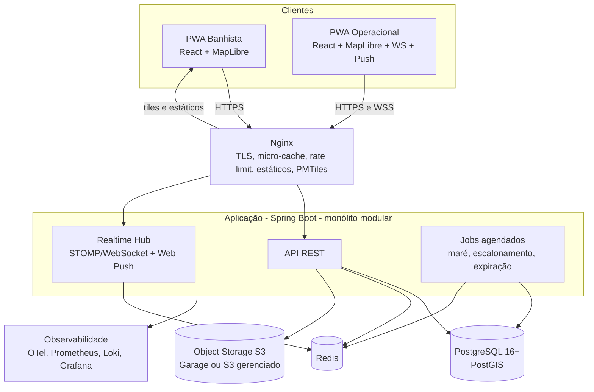
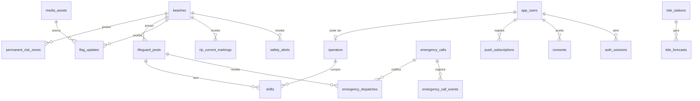
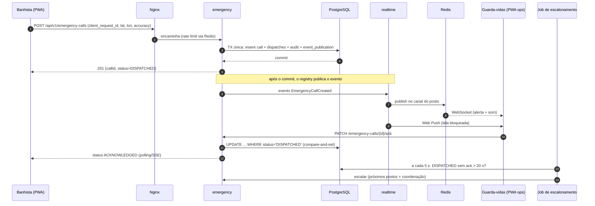

# MarAberto — Arquitetura

> **Versão:** 0.1 (rascunho) · **Data:** 2026-11-06
> **Documento relacionado:** [Requirements.md](./Requirements.md)

---

## 1. Resumo executivo

O **MarAberto** é uma plataforma open source de prevenção e resposta a afogamentos, implantável por qualquer estado. Sua carga é **média** (pico de ~6.000 conexões simultâneas, 95 % leitura), mas seu componente de **SOS é crítico para a vida**.

A arquitetura recomendada é um **monólito modular** em Java/Spring Boot, com **PostgreSQL + PostGIS** como fonte da verdade, **Redis** para cache, rate limit e fan-out de tempo real, **armazenamento de objetos compatível com S3** para fotos, **autenticação embutida no próprio sistema** (Spring Security) e **Nginx** como borda com micro-cache.

O desenho foca em três coisas:

1. **Confiabilidade do SOS**: persistência antes de notificar (Transactional Outbox), reconhecimento obrigatório, escalonamento automático, canais redundantes (WebSocket + Web Push + polling) e fallback para o 193.
2. **Absorver o pico de leitura barato**: cache HTTP/Nginx + Redis, sem WebSocket para o público.
3. **Ser fácil de adotar**: um `docker compose up`, sem componentes pesados obrigatórios, configuração regional por *Region Pack*.

> **Revisão em relação ao documento de análise inicial:** o broker de mensagens **deixa de ser obrigatório** (Kafka e RabbitMQ viram adaptadores opcionais) e o **MinIO deixa de ser o padrão** de armazenamento. Os motivos estão nas seções 3, 11 e 12.

---

## 2. Drivers arquiteturais

| # | Driver | Impacto no desenho |
|---|--------|--------------------|
| 1 | SOS com p95 < 3 s e sem perda silenciosa | Outbox, ack obrigatório, escalonamento, canais redundantes, sonda sintética. |
| 2 | Pico sazonal de leitura (≈ 6.000 simultâneos) | Cache em camadas; leituras públicas sem estado; sem WebSocket para banhistas. |
| 3 | Rede ruim na praia | PWA, payload pequeno, tiles próprios, offline parcial, retries idempotentes. |
| 4 | Adoção por estados com TI pequena | Poucos componentes obrigatórios, Compose, perfis de implantação, runbooks. |
| 5 | LGPD e dados de localização | Detecção de ocupação no cliente, sem trilhas, CPF cifrado, retenção definida. |
| 6 | Longevidade do projeto open source | Fronteiras de módulos verificadas, ADRs, dependências com manutenção ativa. |

---

## 3. Decisões-chave (resumo)

| ADR | Decisão | Em uma frase |
|-----|---------|--------------|
| 001 | Monólito modular (Spring Modulith) | Carga média, equipe pequena, deploy simples; microserviços seriam custo sem retorno. |
| 002 | PostgreSQL + PostGIS como fonte única da verdade | Geoespacial, transações e consistência forte no mesmo lugar. |
| 003 | Transactional Outbox via *event publication registry* | Elimina *dual write* entre banco e eventos. |
| 004 | **Sem broker obrigatório**; RabbitMQ e Kafka como adaptadores opcionais | Volume de eventos é minúsculo; cada broker é custo operacional para o estado. |
| 005 | Redis obrigatório (cache, rate limit, fan-out) | Justificado por pico de leitura e múltiplas instâncias. |
| 006 | **Armazenamento S3-compatível por porta**, com **Garage** como padrão do Compose e **S3 gerenciado** como alternativa | MinIO Community Edition foi arquivado em abril/2026; não é base segura para um projeto novo. |
| 007 | **Autenticação embutida** no módulo `identity` (Spring Security, JWT de vida curta + refresh com rotação, TOTP) | Decisão do projeto: menos peças, identidade própria e independente de sistemas institucionais existentes. O risco (segurança é responsabilidade nossa) é tratado na seção 13.1. |
| 008 | Banhista com *polling* + ETag; WebSocket só para operacionais | Leitura cacheável e barata; WS onde latência importa. |
| 009 | Tiles vetoriais próprios (PMTiles) | Evita depender de servidores públicos do OSM. |
| 010 | Instância única por estado (*single-tenant*) | Soberania de dados e simplicidade; multi-tenant fica fora do núcleo. |
| 011 | Spring Boot **4.1.x** (Java 21 ou 25) | O Boot 3.5 teve o suporte OSS encerrado em 30/06/2026; novo projeto deve nascer na linha suportada. |

### Por que não Kafka (agora)?

| Pergunta | Resposta |
|----------|----------|
| Volume justifica? | Não. SOS: dezenas/dia; bandeiras: centenas/dia; reportes: milhares no pico. Um Postgres resolve com folga. |
| Qual o custo? | Cluster (mínimo 3 brokers para HA), memória, expertise de operação, monitoramento de lag. Um estado pequeno raramente tem isso. |
| O que perdemos sem ele? | Quase nada no MVP: o Outbox já dá entrega *at-least-once* e ordenação por agregado. |
| Quando faz sentido? | (a) consolidar telemetria de várias instalações; (b) alimentar plataforma de dados/analytics; (c) integrar com sistemas estaduais que consomem Kafka. |
| Como não fechar a porta? | Os eventos já nascem como eventos de domínio; o Spring Modulith permite **externalizá-los** para Kafka/AMQP por configuração. Vira um perfil `kafka`, não um requisito. |

> Se o objetivo também for **estudo ou portfólio com Kafka**, o adaptador opcional é o lugar certo: ele agrega valor real (analytics e integração) sem impor o custo a quem só quer instalar e usar.

### Por que não manter o MinIO?

O repositório da edição comunitária do MinIO foi **arquivado em abril de 2026** e não recebe mais correções upstream. Um projeto open source que será instalado por vários órgãos não pode nascer sobre componente congelado. Por isso o código fala com **qualquer S3** através de uma porta (`ObjectStoragePort`) e o Compose traz **Garage** (leve, S3-compatível, binário único) como padrão. Quem usa nuvem pública aponta para o bucket S3 do provedor. Alternativas avaliáveis: SeaweedFS e Ceph RGW (mais peso operacional).

---

## 4. Contexto do sistema (C4 — nível 1)


---

## 5. Contêineres (C4 — nível 2)



**Componentes obrigatórios no perfil mínimo:** Nginx, aplicação, PostgreSQL/PostGIS, Redis, armazenamento S3. **Opcionais:** RabbitMQ, Kafka, stack de observabilidade dedicada, réplica de leitura.

---

## 6. Módulos do monólito

Implementados com **Spring Modulith**: cada módulo é um pacote de topo; só a API pública (`api/`) é visível aos demais; as regras são verificadas por teste (`ApplicationModules.verify()`).

| Módulo | Responsabilidade | Publica eventos | Consome |
|--------|------------------|-----------------|---------|
| `identity` | Cadastro, OTP, CPF (cifrado), login, tokens, MFA (TOTP), papéis, convite de operacionais. | `UserRegistered`, `OperatorInvited` | — |
| `region` | Configuração da instalação, importação de *Region Pack*. | `RegionConfigChanged` | — |
| `beaches` | Praias, zonas críticas permanentes, fichas, GeoJSON público. | `BeachChanged`, `RiskZoneChanged` | `RegionConfigChanged` |
| `operations` | Postos, plantões, bandeiramento, demarcação de correntes. | `ShiftStarted`, `ShiftEnded`, `FlagChanged`, `RipCurrentMarked` | — |
| `emergency` | SOS: criação, despacho, ack, escalonamento, ciclo de vida, desfecho. | `EmergencyCallCreated`, `…Acknowledged`, `…Escalated`, `…Resolved` | — |
| `safety` | Reportes comunitários, quórum, moderação. | `ReportSubmitted`, `AlertActivated`, `AlertClosed` | `FlagChanged` |
| `tides` | Ingestão, previsão, sizígia, consulta. | `TideForecastIngested` | `RegionConfigChanged` |
| `content` | CMS de vídeos e dicas. | `ContentChanged` | — |
| `occupancy` | Contagem anônima e níveis por praia. | `OccupancyLevelChanged` | `BeachChanged` |
| `media` | URLs pré-assinadas, saneamento (EXIF), miniaturas. | `MediaReady`, `MediaRejected` | — |
| `realtime` | WebSocket, Web Push, fan-out via Redis. | — | eventos de `emergency`, `operations`, `safety` |
| `audit` | Trilha imutável (API **síncrona**, na mesma transação). | — | — |
| `analytics` | Visões agregadas, mapa de calor, dados abertos. | — | `EmergencyCallResolved`, `AlertActivated` |
| `shared` | Kernel mínimo (tipos, erros, geoutils). | — | — |

**Dependências permitidas (resumo):** `emergency → operations(api)`, `emergency → audit(api)`, `safety → beaches(api)`, `safety → audit(api)`, `operations → beaches(api)`, `occupancy → beaches(api)`, `realtime` apenas escuta eventos. Qualquer outro acoplamento direto é violação.

> **Auditoria é chamada direta, não evento.** Um evento assíncrono pode se perder entre o commit e a escrita; a trilha de auditoria precisa estar **na mesma transação** do ato auditado.

### Estrutura de pacotes (padrão por módulo)

```
org.MarAberto.<modulo>
├── api/            # interfaces, DTOs e eventos públicos (visíveis a outros módulos)
├── application/    # casos de uso (serviços de aplicação)
├── domain/         # entidades, value objects, regras (sem Spring)
└── infra/          # JPA/JDBC, controllers REST, adaptadores (internos)
```

Pacote-base é sugestão; ajuste ao domínio da organização do projeto.

---

## 7. Modelo de dados

### 7.1 Visão geral



### 7.2 Ajustes sobre o modelo do documento inicial

| # | Ajuste | Motivo |
|---|--------|--------|
| 1 | Remover `crowd_level` de `beaches`. | É dado volátil; vive em Redis e em `occupancy_snapshots` agregado. |
| 2 | Tirar bandeiras de `safety_alerts` e criar `flag_updates`. | Bandeira tem validade, histórico e autoria próprios; misturar com alerta comunitário complica consultas e auditoria. |
| 3 | `emergency_calls` ganha `client_request_id` (único), `accuracy_m`, `version`, `acknowledged_at`, `resolved_at`, `outcome`. | Idempotência, incerteza de GPS, concorrência otimista, métricas de tempo. |
| 4 | Criar `emergency_dispatches` e `emergency_call_events`. | Saber **quem foi notificado** e **quando**; histórico de estados. |
| 5 | `tide_forecasts` passa a ter `station_id`, `source` e `UNIQUE (station_id, forecast_timestamp, tide_type)`. | Ingestão idempotente; várias fontes/estações. |
| 6 | Convenção: polígonos em `geometry(…,4326)`; pontos em `geography(Point,4326)`; distâncias **sempre** em metros via `geography`. | `ST_DWithin` em `geometry` 4326 mede graus, não metros — armadilha clássica. |
| 7 | Consulta de contexto com *fallback* por vizinho mais próximo (`<->`). | A query original não retorna nada se o usuário estiver fora de qualquer polígono de praia. |
| 8 | Adicionar `state_code` (UF) em `beaches`. | Region Pack e filtros. |
| 9 | Migrações com **Flyway**; ids como UUID (considerar UUIDv7 gerado na aplicação para melhor localidade de índice). | Evolução controlada do esquema. |

### 7.3 DDL das tabelas novas ou alteradas (essenciais)

```sql
CREATE EXTENSION IF NOT EXISTS postgis;
CREATE EXTENSION IF NOT EXISTS pgcrypto;

-- Configuração da instalação (linha única)
CREATE TABLE installation_settings (
    id            SMALLINT PRIMARY KEY DEFAULT 1 CHECK (id = 1),
    state_code    CHAR(2) NOT NULL,
    timezone      VARCHAR(50) NOT NULL,            -- ex.: 'America/Maceio'
    map_center    GEOGRAPHY(Point, 4326) NOT NULL,
    emergency_phone VARCHAR(20) NOT NULL DEFAULT '193',
    settings      JSONB NOT NULL DEFAULT '{}'::jsonb, -- parâmetros: quórum, validade da bandeira, tempos de escalonamento
    updated_at    TIMESTAMPTZ NOT NULL DEFAULT NOW()
);

-- Usuários e autenticação (embutidos no sistema)
CREATE TABLE app_users (
    id                 UUID PRIMARY KEY DEFAULT gen_random_uuid(),
    email              VARCHAR(254) NOT NULL UNIQUE,
    email_verified_at  TIMESTAMPTZ,
    password_hash      VARCHAR(255),                -- Argon2id (formato PHC); nulo até o convidado definir a senha
    cpf_cipher         BYTEA,                       -- AES-GCM; chave fora do banco
    cpf_blind_idx      BYTEA UNIQUE,                -- HMAC-SHA256(cpf) para unicidade/busca
    role               VARCHAR(20) NOT NULL,        -- BATHER, LIFEGUARD, COORDINATOR, ADMIN
    status             VARCHAR(20) NOT NULL DEFAULT 'ACTIVE', -- INVITED, ACTIVE, SUSPENDED, DISABLED
    totp_secret_cipher BYTEA,                       -- segredo TOTP cifrado
    totp_enabled_at    TIMESTAMPTZ,
    failed_login_count INT NOT NULL DEFAULT 0,
    locked_until       TIMESTAMPTZ,
    created_at         TIMESTAMPTZ NOT NULL DEFAULT NOW()
);

-- Sessões: refresh token opaco guardado apenas como hash, com rotação e detecção de reuso
CREATE TABLE auth_sessions (
    id              UUID PRIMARY KEY DEFAULT gen_random_uuid(),
    user_id         UUID NOT NULL REFERENCES app_users(id),
    family_id       UUID NOT NULL,                  -- cadeia de rotação; reuso => revoga a família inteira
    refresh_hash    BYTEA NOT NULL UNIQUE,
    user_agent_hash BYTEA,
    created_at      TIMESTAMPTZ NOT NULL DEFAULT NOW(),
    expires_at      TIMESTAMPTZ NOT NULL,
    rotated_at      TIMESTAMPTZ,
    revoked_at      TIMESTAMPTZ
);
CREATE INDEX idx_auth_sessions_family ON auth_sessions(family_id);

-- Tokens de uso único: verificação de e-mail, reset de senha, convite de operacional
CREATE TABLE one_time_tokens (
    id         UUID PRIMARY KEY DEFAULT gen_random_uuid(),
    user_id    UUID NOT NULL REFERENCES app_users(id),
    purpose    VARCHAR(20) NOT NULL,                -- EMAIL_VERIFY, PASSWORD_RESET, OPERATOR_INVITE
    token_hash BYTEA NOT NULL UNIQUE,               -- o token em si só existe no e-mail enviado
    created_by UUID REFERENCES app_users(id),
    expires_at TIMESTAMPTZ NOT NULL,
    used_at    TIMESTAMPTZ,
    created_at TIMESTAMPTZ NOT NULL DEFAULT NOW()
);

CREATE TABLE recovery_codes (
    user_id   UUID NOT NULL REFERENCES app_users(id),
    code_hash BYTEA NOT NULL,
    used_at   TIMESTAMPTZ,
    PRIMARY KEY (user_id, code_hash)
);

-- Plantões
CREATE TABLE shifts (
    id          UUID PRIMARY KEY DEFAULT gen_random_uuid(),
    operator_id UUID NOT NULL REFERENCES app_users(id),
    post_id     UUID NOT NULL REFERENCES lifeguard_posts(id),
    started_at  TIMESTAMPTZ NOT NULL DEFAULT NOW(),
    ended_at    TIMESTAMPTZ,
    location    GEOGRAPHY(Point, 4326)
);
CREATE UNIQUE INDEX uq_shift_open_per_operator ON shifts(operator_id) WHERE ended_at IS NULL;

-- Bandeiramento (histórico com validade)
CREATE TABLE flag_updates (
    id          UUID PRIMARY KEY DEFAULT gen_random_uuid(),
    beach_id    UUID NOT NULL REFERENCES beaches(id),
    post_id     UUID REFERENCES lifeguard_posts(id),
    flag        VARCHAR(20) NOT NULL,              -- GREEN, YELLOW, RED, DOUBLE_RED
    media_id    UUID,
    set_by      UUID NOT NULL REFERENCES app_users(id),
    valid_until TIMESTAMPTZ NOT NULL,
    created_at  TIMESTAMPTZ NOT NULL DEFAULT NOW()
);
CREATE INDEX idx_flag_current ON flag_updates (beach_id, created_at DESC);

-- Demarcação dinâmica de correntes
CREATE TABLE rip_current_markings (
    id          UUID PRIMARY KEY DEFAULT gen_random_uuid(),
    beach_id    UUID NOT NULL REFERENCES beaches(id),
    geometry    GEOMETRY(Polygon, 4326) NOT NULL,
    created_by  UUID NOT NULL REFERENCES app_users(id),
    valid_until TIMESTAMPTZ NOT NULL,
    created_at  TIMESTAMPTZ NOT NULL DEFAULT NOW()
);
CREATE INDEX idx_rip_geom ON rip_current_markings USING GIST(geometry);

-- SOS (substitui a versão do documento inicial)
CREATE TABLE emergency_calls (
    id                UUID PRIMARY KEY DEFAULT gen_random_uuid(),
    client_request_id UUID NOT NULL UNIQUE,        -- idempotência (duplo toque / retry)
    citizen_user_id   UUID,                        -- nulo se SOS sem conta (ver D-01)
    location          GEOGRAPHY(Point, 4326) NOT NULL,
    accuracy_m        NUMERIC(7,1),
    status            VARCHAR(20) NOT NULL,        -- DISPATCHED, ACKNOWLEDGED, EN_ROUTE, ON_SCENE, RESOLVED, CANCELLED, FALSE_ALARM
    assigned_post_id  UUID REFERENCES lifeguard_posts(id),
    outcome           JSONB,
    version           BIGINT NOT NULL DEFAULT 0,   -- lock otimista
    created_at        TIMESTAMPTZ NOT NULL DEFAULT NOW(),
    acknowledged_at   TIMESTAMPTZ,
    resolved_at       TIMESTAMPTZ
);
CREATE INDEX idx_calls_loc ON emergency_calls USING GIST(location);
CREATE INDEX idx_calls_open ON emergency_calls (created_at) WHERE status = 'DISPATCHED';

CREATE TABLE emergency_dispatches (
    call_id     UUID NOT NULL REFERENCES emergency_calls(id),
    post_id     UUID NOT NULL REFERENCES lifeguard_posts(id),
    round       SMALLINT NOT NULL DEFAULT 1,       -- 1 = primeira notificação; 2+ = escalonamento
    distance_m  INT,
    notified_at TIMESTAMPTZ NOT NULL DEFAULT NOW(),
    seen_at     TIMESTAMPTZ,
    PRIMARY KEY (call_id, post_id, round)
);

CREATE TABLE emergency_call_events (
    id        BIGSERIAL PRIMARY KEY,
    call_id   UUID NOT NULL REFERENCES emergency_calls(id),
    status    VARCHAR(20) NOT NULL,
    actor_id  UUID,
    at        TIMESTAMPTZ NOT NULL DEFAULT NOW()
);

-- Auditoria append-only com encadeamento de hash
CREATE TABLE audit_log (
    id            BIGSERIAL PRIMARY KEY,
    occurred_at   TIMESTAMPTZ NOT NULL DEFAULT NOW(),   -- UTC
    actor_user_id UUID,
    action        VARCHAR(60) NOT NULL,
    entity_type   VARCHAR(40) NOT NULL,
    entity_id     VARCHAR(64),
    device_geo    GEOGRAPHY(Point, 4326),
    payload       JSONB,
    prev_hash     BYTEA,
    hash          BYTEA NOT NULL
);
REVOKE UPDATE, DELETE ON audit_log FROM PUBLIC;          -- e do papel da aplicação
-- Em produção: particionar por mês e restringir o papel da aplicação a INSERT.

-- Maré
CREATE TABLE tide_stations (
    id        UUID PRIMARY KEY DEFAULT gen_random_uuid(),
    name      VARCHAR(100) NOT NULL,
    source    VARCHAR(30) NOT NULL,                 -- DHN_TABLE, EXTERNAL_API, HARMONIC
    location  GEOGRAPHY(Point, 4326),
    timezone  VARCHAR(50) NOT NULL
);
-- tide_forecasts: acrescentar station_id, source e UNIQUE(station_id, forecast_timestamp, tide_type)

-- Mídia, push, consentimentos
CREATE TABLE media_assets (
    id           UUID PRIMARY KEY DEFAULT gen_random_uuid(),
    object_key   VARCHAR(255) NOT NULL,
    content_type VARCHAR(60) NOT NULL,
    size_bytes   BIGINT,
    sha256       BYTEA,
    owner_id     UUID NOT NULL,
    status       VARCHAR(20) NOT NULL DEFAULT 'PENDING', -- PENDING, READY, REJECTED
    created_at   TIMESTAMPTZ NOT NULL DEFAULT NOW()
);

CREATE TABLE push_subscriptions (
    id         UUID PRIMARY KEY DEFAULT gen_random_uuid(),
    user_id    UUID NOT NULL REFERENCES app_users(id),
    endpoint   TEXT NOT NULL UNIQUE,
    p256dh     TEXT NOT NULL,
    auth       TEXT NOT NULL,
    created_at TIMESTAMPTZ NOT NULL DEFAULT NOW()
);

CREATE TABLE consents (
    user_id     UUID NOT NULL REFERENCES app_users(id),
    doc_type    VARCHAR(30) NOT NULL,               -- TERMS, PRIVACY
    version     VARCHAR(20) NOT NULL,
    accepted_at TIMESTAMPTZ NOT NULL DEFAULT NOW(),
    PRIMARY KEY (user_id, doc_type, version)
);

-- Histórico agregado de ocupação (sem identificadores)
CREATE TABLE occupancy_snapshots (
    beach_id     UUID NOT NULL REFERENCES beaches(id),
    bucket_start TIMESTAMPTZ NOT NULL,
    level        VARCHAR(20) NOT NULL,
    sample_count INT NOT NULL,
    PRIMARY KEY (beach_id, bucket_start)
);
```

> As tabelas `beaches`, `permanent_risk_zones`, `educational_videos`, `lifeguard_posts` e `safety_alerts` seguem o documento inicial, com os ajustes da seção 7.2. A tabela `event_publication` é criada pelo Spring Modulith (Outbox).

### 7.4 Consulta de contexto do banhista (com *fallback*)

```sql
-- Praia que contém o usuário; se nenhuma, a mais próxima (KNN)
WITH me AS (SELECT ST_SetSRID(ST_Point(:lon, :lat), 4326) AS p),
inside AS (
    SELECT b.* FROM beaches b, me WHERE ST_Contains(b.boundary, me.p) LIMIT 1
),
nearest AS (
    SELECT b.* FROM beaches b, me ORDER BY b.boundary <-> me.p LIMIT 1
),
chosen AS (SELECT * FROM inside UNION ALL SELECT * FROM nearest WHERE NOT EXISTS (SELECT 1 FROM inside) LIMIT 1)
SELECT c.id, c.name, c.beach_type,
       z.name AS risk_zone_name, z.danger_level, z.guidelines
FROM chosen c
LEFT JOIN permanent_risk_zones z
       ON z.beach_id = c.id
      AND ST_Contains(z.geometry, (SELECT p FROM me));
```

### 7.5 Postos elegíveis a um SOS (distância em metros)

```sql
SELECT p.id, p.name,
       ST_Distance(p.location, :sos_point::geography) AS distance_m
FROM lifeguard_posts p
JOIN shifts s ON s.post_id = p.id AND s.ended_at IS NULL
WHERE p.status IN ('ACTIVE', 'PATROL')
  AND ST_DWithin(p.location, :sos_point::geography, p.coverage_radius_meters)
ORDER BY distance_m
LIMIT 3;
```

---

## 8. Fluxos críticos

### 8.1 SOS (caminho crítico)



**Pontos de projeto**

1. **Persistir antes de notificar.** O 201 só volta depois do commit. Se o app cair em seguida, o Outbox republica o evento na reinicialização.
2. **Idempotência.** `client_request_id` evita SOS duplicado por duplo toque ou retry de rede.
3. **Ack por *compare-and-set*.** `UPDATE emergency_calls SET status='ACKNOWLEDGED', assigned_post_id=?, version=version+1 WHERE id=? AND status='DISPATCHED'` — o primeiro posto a assumir vence; os demais recebem "já assumido". Sem lock longo, sem corrida.
4. **Escalonamento durável.** Job (com ShedLock para múltiplas instâncias) consulta o índice parcial `idx_calls_open`. Sem dependência de timer em memória.
5. **Canais redundantes.** WebSocket, Web Push e *polling de reconciliação* (`GET /operations/sos/open` a cada 10 s no console). Qualquer um sozinho entrega.
6. **Cliente honesto.** Se o POST não for confirmado em ~5 s, o app mostra **"Não foi possível enviar — ligue 193"** com botão de chamada. Nunca exibir "socorro a caminho" sem ack.
7. **Anti-abuso.** Redis (token bucket) limita SOS por usuário/dispositivo; geofence exige localização dentro da praia (+ margem).

### 8.2 Bandeiramento

1. Guarda-vidas autenticado lança a bandeira (`POST /flags`), com foto opcional (já enviada via URL pré-assinada).
2. Transação grava `flag_updates` + auditoria + evento `FlagChanged`.
3. Listener invalida `flag:current:{beachId}` no Redis e faz *write-through* do novo valor.
4. Banhistas veem a mudança em até 60 s (TTL do micro-cache + ETag). Operacionais veem imediatamente por WebSocket.
5. **Expiração:** a UI compara `valid_until` com o relógio do servidor; vencida → "desatualizada" (RN01).

### 8.3 Reporte comunitário e quórum

1. `POST /reports` (usuário autenticado; rate limit 5/h).
2. Em uma transação, busca reportes do mesmo tipo em raio de 100 m e 30 min:

```sql
SELECT COUNT(DISTINCT created_by_user_id)
FROM safety_alerts
WHERE alert_type = :type
  AND created_at > NOW() - INTERVAL '30 minutes'
  AND ST_DWithin(location, :point::geography, 100)
  AND status IN ('PENDING_APPROVAL','ACTIVE');
```

3. Se `≥ 3`, promove os alertas a `ACTIVE` e emite `AlertActivated`.
4. **Concorrência:** dois reportes simultâneos podem não "ver" um ao outro. Solução: `pg_advisory_xact_lock(hash(beach_id, alert_type))` no início da transação — barato e suficiente neste volume.
5. **Sybil/abuso:** exigir conta, limitar por usuário, e moderador pode reverter alertas por quórum.

### 8.4 Ingestão de maré

1. Job `@Scheduled(cron = "0 5 0 * * *", zone = "<fuso da instalação>")`.
2. `TideProvider` (porta) com adaptadores: **cadastro manual autorizado**, **importação de tábuas oficiais (DHN)**, **API externa** e, opcionalmente, **previsão harmônica** a partir de constantes da estação.
3. Valida (alturas plausíveis, ordem alternada preamar/baixa-mar) e faz *upsert* idempotente em `tide_forecasts` para os próximos 7+ dias.
4. Calcula `is_spring_tide` pela amplitude/fase lunar (RN07).
5. Atualiza o Redis. Falha do provedor → **mantém dados do banco** e dispara alerta se restarem < 48 h de previsão.
6. Circuit breaker e timeout curtos no adaptador externo.

### 8.5 Ocupação (privacidade por desenho)

1. O cliente baixa o GeoJSON das praias (cacheado, ETag) e **compara localmente** a posição com o polígono.
2. Se estiver dentro e o app em primeiro plano, envia a cada ~5 min `POST /occupancy/heartbeat {beachId, token}`; `token` é aleatório, **gerado no dispositivo e rotacionado diariamente**.
3. No servidor: `ZADD occ:{beachId} <agora> sha256(token + salt_do_dia)`; `ZREMRANGEBYSCORE` remove > 15 min; `ZCARD` dá a contagem.
4. Nível = limiares por praia; abaixo da amostra mínima *k* → "dados insuficientes".
5. **Limitações assumidas:** o servidor não consegue verificar a posição enviada pelo cliente (o dado é indicativo, não pericial); o IP **não é registrado** nesses endpoints (configuração do Nginx).

### 8.6 Upload de foto

1. Cliente pede `POST /media/upload-url` (tipo e tamanho declarados).
2. API devolve **URL pré-assinada** curta (5 min), com `Content-Type` e tamanho máximos amarrados; registra `media_assets` em `PENDING`.
3. Cliente envia direto ao armazenamento.
4. Evento de upload (ou *callback* da API) dispara o **saneamento**: valida *magic bytes*, remove EXIF/GPS, redimensiona, gera miniatura → `READY` (ou `REJECTED`).
5. Só mídias `READY` são servidas.

---

## 9. Estratégia de cache

**Camadas:** (1) navegador/Service Worker → (2) Nginx *micro-cache* → (3) Redis → (4) PostgreSQL.

| Dado | Onde | Chave / política | Invalidação |
|------|------|------------------|-------------|
| Praias e zonas (GeoJSON) | HTTP + Redis | `geo:beaches:v{versão}`; `ETag`; `max-age=3600` | `BeachChanged`/`RiskZoneChanged` incrementa a versão. |
| Bandeira atual | HTTP (30–60 s) + Redis | `flag:current:{beachId}` | `FlagChanged` (write-through). |
| Maré do dia | HTTP + Redis | `tide:{station}:{yyyy-MM-dd}`, TTL ~24 h | Reescrito na ingestão diária. |
| Vídeos educativos | HTTP + Redis | `content:videos:v{n}` | `ContentChanged`. |
| Ocupação | Redis | `occ:{beachId}` (ZSET, janela 15 min) | Expiração por janela. |
| Rate limit | Redis | `rl:{rota}:{sujeito}` | Janela do bucket. |
| Tiles do mapa | Nginx/CDN | arquivo PMTiles estático, `Range` requests | Troca de arquivo versionado. |

**Armadilhas tratadas**

| Problema | Mitigação |
|----------|-----------|
| *Cache stampede* no pico | `proxy_cache_lock on`, `proxy_cache_use_stale updating error timeout`, `stale-while-revalidate`, `sync=true` no `@Cacheable`. |
| Invalidação inconsistente | Invalidação por **evento de domínio** + TTL curto como rede de segurança. |
| *Cache penetration* | IDs são UUID validados na borda; respostas 404 com TTL curto. |
| Redis indisponível | Leituras caem para o banco (degradado); rate limit do SOS **falha aberto** (nunca bloquear socorro por falha de infraestrutura); reportes **falham fechado**. |

---

## 10. Tempo real

| Público | Canal | Motivo |
|---------|-------|--------|
| Banhista | *Polling* com `ETag` (30–60 s); SSE opcional para status do **próprio** SOS | Cacheável, barato, robusto em rede ruim. |
| Operacional | STOMP/WebSocket + Web Push + polling de reconciliação | Latência importa; precisa funcionar em segundo plano. |

- **Fan-out entre instâncias:** a instância que processa o evento publica em canal Redis; todas retransmitem aos seus clientes conectados. Redis Pub/Sub é *at-most-once* — por isso **a verdade está no banco** e o console reconcilia periodicamente.
- **Reconexão:** *backoff* exponencial com *jitter*; ao reconectar, o cliente busca o estado atual (SOS abertos) em vez de confiar em mensagens perdidas.
- **Web Push:** payload mínimo (id e tipo); o conteúdo é buscado após abrir. Observação: o suporte a push em iOS depende de a PWA estar instalada — validar com os dispositivos reais dos operacionais.
- **Escala:** 300 operacionais em WebSocket é trivial; o público **não** mantém conexão.

---

## 11. Eventos e mensageria

### 11.1 Padrão adotado: eventos de domínio + Transactional Outbox

- Módulos publicam eventos de domínio no `ApplicationEventPublisher`.
- O **event publication registry** (JDBC) grava o evento **na mesma transação** do negócio e o marca como concluído após o listener rodar. Eventos incompletos são **reenviados** na reinicialização.
- Listeners usam `@ApplicationModuleListener` (assíncrono, após commit).
- **Semântica de entrega: *at-least-once***. Justificativa: perder um alerta é inaceitável; duplicar é tolerável se os consumidores forem **idempotentes** (ex.: Web Push com `tag` por `callId`; atualizações por *compare-and-set*; tabela `processed_events` quando necessário).
- *Exactly-once* não é necessário nem realista fora do banco; *at-most-once* é inaceitável para SOS.

### 11.2 Catálogo de eventos principais

| Evento | Produtor | Consumidores | Observação |
|--------|----------|--------------|------------|
| `EmergencyCallCreated` | emergency | realtime, analytics | Caminho crítico; reenvio garantido pelo Outbox. |
| `EmergencyCallAcknowledged` | emergency | realtime | Cancela alerta nos demais postos. |
| `EmergencyCallEscalated` | emergency | realtime | Disparado pelo job de escalonamento. |
| `FlagChanged` | operations | realtime, beaches/cache, safety | Invalida cache. |
| `AlertActivated` | safety | realtime, analytics | Origem pode ser quórum ou moderador. |
| `RiskZoneChanged` / `BeachChanged` | beaches | cache, occupancy | Incrementa versão do GeoJSON. |
| `TideForecastIngested` | tides | cache | — |
| `MediaReady` / `MediaRejected` | media | operations, safety | Libera anexo. |

### 11.3 Perfis opcionais de broker

| Perfil | Quando | O que muda |
|--------|--------|-----------|
| *(padrão)* sem broker | Perfil mínimo e equilibrado | Tudo roda in-process + Outbox. |
| `rabbit` | Isolar trabalhadores (envio de push, processamento de imagem) em processos separados, ou múltiplas instâncias com muita carga de tarefas. | Eventos selecionados são **externalizados** para AMQP; *workers* consomem filas com retry e DLQ. |
| `kafka` | Analytics contínuo, consolidação multi-instalação, integração com sistemas que já usam Kafka. | Eventos externalizados para tópicos particionados por `beachId`; consumidores independentes. |

Ambos entram via **externalização do Spring Modulith**, sem alterar o código de domínio.

---

## 12. Armazenamento de objetos

- **Porta:** `ObjectStoragePort` (`presignPut`, `presignGet`, `delete`, `head`) implementada sobre o **cliente S3** (AWS SDK v2 ou equivalente).
- **Padrão do Compose:** **Garage** (S3-compatível, leve). **Alternativa:** bucket S3 de nuvem pública, ou SeaweedFS/Ceph RGW onde já exista.
- **Buckets:** `media-public` (miniaturas/fotos aprovadas, leitura via URL assinada ou CDN) e `media-private` (originais pendentes).
- **Política:** *lifecycle* para expirar originais `PENDING`/`REJECTED`; versionamento desligado; criptografia em repouso quando disponível.
- **Teste de contrato** da porta rodando contra Garage no CI, para evitar surpresas ao trocar de provedor.

---

## 13. Segurança e privacidade

### 13.1 Identidade e autorização (autenticação embutida)

Registro, login e papéis vivem **dentro do sistema** (módulo `identity`), sem provedor de identidade externo. Como a responsabilidade de segurança passa a ser nossa, usamos **Spring Security** e primitivas padrão; **nada de criptografia ou protocolo caseiro**.

| Tema | Decisão |
|------|---------|
| Senhas | **Argon2id** (formato PHC). Mínimo de 10 caracteres, bloqueio de senhas comuns, sem regras de composição obrigatória. |
| Access token | **JWT curto (≈ 10–15 min)** assinado pela aplicação com chave assimétrica (`kid` para rotação) e validado **localmente** — sem consultar Redis ou banco a cada requisição. Fica **em memória** no cliente, nunca em `localStorage`. |
| Refresh token | Opaco, aleatório (256 bits), guardado **só como hash** em `auth_sessions`; **rotação a cada uso** com **detecção de reuso** (reuso revoga toda a família). Cookie `HttpOnly; Secure; SameSite=Strict`, restrito à rota `/api/v1/auth`. |
| MFA | **TOTP (RFC 6238)** obrigatório para `COORDINATOR` e `ADMIN`, recomendado para `LIFEGUARD`; segredo cifrado; códigos de recuperação guardados como hash. |
| Cadastro de banhista | CPF validado pelos dígitos, e-mail confirmado por token de uso único (hash, expira). CPF cifrado (AES-GCM) + índice cego. |
| Operacionais | **Somente por convite** (token de uso único, 72 h): o convidado define a senha e ativa o TOTP no primeiro acesso. Sem autocadastro. |
| Recuperação de senha | Token de uso único, hash no banco, expira em 30 min, resposta sempre genérica (anti-enumeração). |
| Anti-força-bruta | Limite por conta **e** por IP (Redis; se indisponível, limite local por instância), bloqueio progressivo (`locked_until`), mensagens e tempos de resposta uniformes. |
| Revogação | Access token curto + **revalidação do status do usuário em operações sensíveis** (ack de SOS, bandeira, moderação) com cache local de ~30 s: desativar um operador vale em até ~30 s. |
| WebSocket | Access token enviado no frame `CONNECT`; renovado a cada reconexão. |
| CSRF | O refresh depende de cookie `SameSite=Strict` + verificação de `Origin`; chamadas autenticadas usam `Authorization: Bearer`, não exposto a CSRF. |
| Chaves | Chave privada de assinatura e chaves de cifragem vindas de segredo (fora do repositório); rotação com duas chaves ativas. |
| Federação (opcional) | gov.br ou outro OIDC como **cliente OIDC embutido no backend** (R2), atrás da porta `IdentityPort`; não é requisito. |

**Consequência de projeto:** como o JWT é validado localmente, **falha de login/refresh não derruba quem já está autenticado** — o SOS de um operador com sessão vigente continua funcionando.

**Por que isso exige disciplina:** autenticação própria troca uma dependência por responsabilidade. Mitigações obrigatórias: testes automatizados do fluxo de tokens (rotação, reuso, expiração), **teste de invasão focado em autenticação antes do R1** (Etapa 10), SAST/SCA no CI e revisão de código dedicada ao módulo `identity`.

### 13.2 Matriz de permissões

| Recurso | Anônimo | Banhista | Guarda-vidas | Coordenador | Admin |
|---------|:-------:|:--------:|:------------:|:-----------:|:-----:|
| Mapa, maré, fichas, vídeos | ✔ | ✔ | ✔ | ✔ | ✔ |
| Heartbeat de ocupação | ✔ | ✔ | ✔ | ✔ | ✔ |
| SOS | D-01 | ✔ | ✔ | ✔ | ✔ |
| Reportar incidente | ✘ | ✔ | ✔ | ✔ | ✔ |
| Lançar bandeira / iniciar plantão | ✘ | ✘ | ✔ (seu posto) | ✔ | ✔ |
| Moderar reportes / demarcar correntes | ✘ | ✘ | ✔ (sua área) | ✔ | ✔ |
| Receber/atender SOS | ✘ | ✘ | ✔ | ✔ | ✔ |
| Painel tático e histórico | ✘ | ✘ | ✘ | ✔ | ✔ |
| CMS de conteúdo; gestão de praias/zonas | ✘ | ✘ | ✘ | ✔ | ✔ |
| Gestão de usuários e configuração regional | ✘ | ✘ | ✘ | convite | ✔ |

Autorização por **papel + escopo** (posto/praia) validada no servidor, nunca só no cliente.

### 13.3 Modelo de ameaças (resumo)

| Ameaça | Mitigação |
|--------|-----------|
| Spam/abuso do SOS | Rate limit (fail-open), geofence, marcação de falso alarme, suspensão de contas. |
| Reportes falsos coordenados (Sybil) | Conta obrigatória, limite por usuário, reversão por moderador, auditoria. |
| Falsificação de localização | Aceita como limitação; correlacionar com geofence e moderação humana. |
| Vazamento de CPF | Cifragem AES-GCM, índice cego, chave fora do banco, nunca em logs, mascaramento na UI. |
| Upload malicioso | URL pré-assinada com tipo/tamanho, verificação de *magic bytes*, remoção de EXIF/GPS, bucket privado para originais. |
| XSS via CMS | Sanitização no backend, CSP restritiva, YouTube apenas por ID validado (regex). |
| Roubo de sessão de operacional | MFA (TOTP), access token curto, rotação de refresh com detecção de reuso, revalidação de status em operações sensíveis, alerta de login incomum. |
| Força bruta / *credential stuffing* | Argon2id, limite por conta e IP, bloqueio progressivo, respostas uniformes, bloqueio de senhas comuns. |
| Negação de serviço no pico | Cache, rate limit na borda, separação de rotas críticas, limites de conexão. |
| Cadeia de suprimentos | Dependabot/Renovate, SCA, imagens fixadas por digest, SBOM nos releases. |
| Adulteração de auditoria | Tabela append-only, encadeamento de hash, backup separado. |

### 13.4 LGPD (resumo técnico)

Minimização (sem trilha de localização), retenção por tabela, direitos do titular (exportação/exclusão), cifragem em trânsito e repouso, `youtube-nocookie.com`, RIPD versionado em `docs/`. Veja a seção 8 de Requirements.md. Validar bases legais com o jurídico do órgão.

---

## 14. Observabilidade

**Stack:** OpenTelemetry (traces e métricas) → Prometheus; logs estruturados (JSON) → Loki; dashboards e alertas no Grafana. No perfil mínimo, versão enxuta (Prometheus + Grafana + logs em arquivo rotacionado).

### Métricas de negócio e de SLO

| Métrica | Tipo | Uso |
|---------|------|-----|
| `sos_created_total` | counter | Volume. |
| `sos_time_to_notify_seconds` | histogram | **RNF01** (p95 < 3 s). |
| `sos_time_to_ack_seconds` | histogram | Eficiência operacional. |
| `sos_unacked_current` | gauge | Alerta imediato. |
| `outbox_incomplete_events` | gauge | Saúde do Outbox. |
| `ws_connections_current` | gauge | Operacionais conectados. |
| `push_delivery_failures_total` | counter | Canal de push. |
| `tide_days_ahead` | gauge | RNF03. |
| `cache_hit_ratio` (Nginx/Redis) | gauge | RNF08. |
| `flag_staleness_seconds` por praia | gauge | RN01. |

### Alertas

| Alerta | Condição | Severidade |
|--------|----------|------------|
| SOS sem reconhecimento | `sos_unacked_current > 0` por > 20 s | **Crítico** (aciona coordenação) |
| Outbox travado | `outbox_incomplete_events > 0` por > 60 s | Crítico |
| Sonda sintética falhou | canário de SOS não chegou ao console em 5 s | Crítico |
| Maré desatualizada | `tide_days_ahead < 2` | Alto |
| 5xx elevado / latência p95 alta | limiares por rota | Alto |
| Disco, memória, conexões do banco | limiares | Médio |

### Sonda sintética (canário)

A cada minuto, um usuário de teste dispara um SOS **simulado** numa praia de teste e um console de teste confirma o recebimento. Isso mede RNF01 de ponta a ponta e detecta quebras silenciosas (ex.: push parado) antes do verão.

---

## 15. Implantação

### 15.1 Perfis (solução mais barata → preparada para crescimento)

| | **Mínimo** (mais barato) | **Equilibrado** | **Crescimento** |
|---|---|---|---|
| Topologia | 1 VM (≈ 4 vCPU / 8 GB, a validar) com Docker Compose | 2 instâncias da app + 1 VM de banco com *standby* | N instâncias, Postgres HA, réplica de leitura, CDN |
| Componentes | Nginx, app, Postgres/PostGIS, Redis, Garage, observabilidade enxuta | + stack Grafana dedicada; RabbitMQ opcional | + Kafka opcional; tiles/estáticos em CDN; orquestração |
| Disponibilidade alvo | 99,5 % | 99,9 % | 99,95 % |
| Custo relativo | $ | $$ | $$$ |
| Indicado para | Estado que quer começar; baixa temporada | Alta temporada com SOS em produção | Vários polos de praia, grandes eventos |

**Recomendação:** começar em **Mínimo** com backup testado e **escalar para Equilibrado antes da alta temporada**. Não há necessidade comprovada de Kubernetes para esta carga; Compose (ou Docker Swarm, se o órgão já usar) basta.

### 15.2 Estrutura de implantação

```
deploy/
├── compose.yaml                 # perfil mínimo
├── compose.balanced.yaml        # overrides do perfil equilibrado
├── .env.example
├── nginx/                       # nginx.conf, micro-cache, headers, limites
├── observability/               # otel-collector, prometheus, loki, dashboards Grafana
├── backup/                      # scripts pg_basebackup + WAL + teste de restauração
└── runbooks/                    # SOS parado, restore, rotação de segredos, pré-temporada
```

### 15.3 CI/CD

Pipeline (GitHub Actions ou Jenkins): build → testes unitários → testes de módulos (`verify`) → testes de integração com **Testcontainers** (PostGIS, Redis, Garage) → SAST/SCA → imagem versionada (digest + SBOM) → publicação no registry → implantação por tag. *Releases* semânticos com *changelog*.

### 15.4 Backup e recuperação

- `pg_basebackup` diário + arquivamento de WAL (ferramenta como pgBackRest ou WAL-G) → **RPO ≤ 15 min**.
- Cópia fora da instalação (outro bucket/site).
- **Teste de restauração trimestral** (runbook + registro). Backup não testado não é backup.
- Objetos de mídia: replicação/versionamento conforme o provedor.

---

## 16. Resiliência e modos de falha

| Falha | Efeito | Comportamento projetado |
|-------|--------|-------------------------|
| PostgreSQL indisponível | SOS não pode ser criado | Cliente exibe em ≤ 5 s "ligue 193"; alerta crítico; leitura pública servida do micro-cache (*stale*). |
| Redis indisponível | Cache/rate limit/fan-out degradados | Leituras vão ao banco; SOS **fail-open**; console passa a depender do polling de reconciliação (10 s). |
| WebSocket caiu | Console não recebe em tempo real | Web Push e polling entregam; reconexão com backoff. |
| Serviço de push indisponível | Sem alerta em segundo plano | WS e polling continuam; alerta de falha de push. |
| Login/refresh degradado (banco ou Redis) | Sem novos logins/refresh | Access tokens vigentes continuam validados localmente; operacionais mantêm a sessão até a expiração; alerta. |
| Armazenamento S3 indisponível | Sem fotos | Núcleo (SOS, bandeira, mapa) segue; uploads falham com mensagem clara. |
| Provedor de maré fora | Previsão não renova | Serve do banco; alerta se < 48 h restantes. |
| Perda de rede do guarda-vidas | Console cego | Indicador visível "sem conexão"; procedimento operacional de contingência (rádio/telefone); SMS como extensão futura. |
| Instância da app cai | Redução de capacidade | Nginx remove do *upstream*; Outbox republica eventos pendentes ao subir. |

**Padrões:** *timeouts* explícitos em toda chamada externa; *retry* apenas em operações idempotentes; *circuit breaker* (Resilience4j) para provedor de maré e SMTP; *bulkhead* separando pools das rotas críticas (SOS/ops) das rotas públicas.

---

## 17. Riscos arquiteturais

| Categoria | Risco | Mitigação |
|-----------|-------|-----------|
| **Dual write** | Gravar SOS no banco e notificar por outro canal pode perder o alerta se o app cair entre as duas ações. | Transactional Outbox (event publication registry) + reenvio na inicialização + reconciliação por polling. |
| **Dual write** | Invalidar cache e gravar no banco em passos separados. | Invalidação por evento + TTL curto; leitura sempre tolera dado levemente antigo (bandeira tem validade explícita). |
| **Concorrência** | Dois postos assumem o mesmo SOS. | `UPDATE … WHERE status='DISPATCHED'` (CAS) + `version`. |
| **Concorrência** | Quórum não enxerga reportes simultâneos. | `pg_advisory_xact_lock` por (praia, tipo). |
| **Concorrência** | Plantões duplicados do mesmo operador. | Índice único parcial `ended_at IS NULL`. |
| **Consistência** | Eventos duplicados após *replay* do Outbox. | Consumidores idempotentes (tags de push, CAS, `processed_events`). |
| **Consistência** | Mensagens Pub/Sub perdidas no Redis. | Verdade no banco; reconciliação periódica no console. |
| **Escalabilidade** | Pico de leitura de verão. | Micro-cache Nginx + Redis; sem WS para público; tiles estáticos; pré-escalonar para o perfil Equilibrado. |
| **Escalabilidade** | Geoconsultas lentas. | Índices GIST, `ST_DWithin` sobre `geography`, EXPLAIN nos testes de carga; polígonos simplificados para o cliente. |
| **Segurança** | Vazamento de dados pessoais/CPF. | Seção 13. |
| **Segurança** | Abuso do SOS ou falsos reportes. | Rate limit, geofence, moderação, auditoria. |
| **Operacional** | Estado sem equipe para operar a plataforma. | Perfil mínimo, runbooks, sonda sintética, atualizações documentadas. |
| **Dependência** | Componente que perde manutenção (como ocorreu com o MinIO CE). | Portas/adaptadores para S3, tide e broker; revisão semestral de dependências no projeto. |
| **Produto** | Falsa sensação de segurança ("socorro enviado"). | "Ligar 193" sempre visível; estados do SOS explícitos; texto legal; ack obrigatório. |
| **Legal** | Responsabilidade civil e tratamento de dados. | Termos claros; controlador é o órgão; revisão jurídica local. |

---

## 18. Alternativas consideradas

| Alternativa | Veredito |
|-------------|----------|
| **Microserviços** (SOS separado) | Rejeitada. Carga não exige; multiplica operação. Se um dia o SOS precisar de isolamento, o módulo `emergency` já tem fronteira para ser extraído. |
| **Event Sourcing / CQRS** | Rejeitada. Sem necessidade; auditoria já atendida por `audit_log` + `emergency_call_events`. |
| **Kafka como espinha dorsal** | Rejeitada para o núcleo; mantida como adaptador opcional (seção 3 e 11.3). |
| **RabbitMQ obrigatório** (proposta inicial) | Rebaixada a opcional. Útil para isolar *workers*, mas não necessário no MVP. |
| **WebSocket para todos os banhistas** | Rejeitada. Polling cacheável é mais barato e resiliente. |
| **Keycloak / IdP externo** | Descartado por decisão do projeto (menos peças, identidade própria). Continua possível como adaptador OIDC opcional se um estado exigir SSO institucional. |
| **MongoDB/NoSQL para geodados** | Rejeitada. PostGIS resolve melhor e mantém consistência forte. |
| **Elasticsearch** | Rejeitada. Não há busca textual complexa no escopo. |
| **Kubernetes** | Rejeitada para o início. Avaliar apenas no perfil Crescimento. |
| **MinIO** | Rejeitado como padrão (projeto comunitário arquivado). |
| **Mais simples:** apenas Postgres + app + Nginx, sem Redis | Possível em demonstração, mas sem rate limit distribuído nem fan-out; não recomendado para produção com SOS. |
| **Mais complexa:** multi-região, Postgres HA com Patroni, CDN global | Reservada ao perfil Crescimento, se houver demanda comprovada. |

---

## 19. Open source: licença, governança e adoção

### Licença (decisão D-06)

| Opção | Vantagem | Desvantagem |
|-------|----------|-------------|
| **Apache-2.0** | Adoção máxima, concessão de patentes, amigável a órgãos públicos e fornecedores. | Forks proprietários são permitidos; melhorias podem não voltar. |
| **AGPL-3.0** | Quem hospedar versão modificada deve compartilhar o código; protege contra *fechamento*. | Alguns órgãos/fornecedores evitam AGPL; pode reduzir adoção. |

**Decisão:** manter **MIT**, já presente no arquivo `LICENSE`, para reduzir barreiras de adoção e manter a licença alinhada ao estado atual do repositório. Conteúdo (textos educativos, imagens) pode usar licença separada (ex.: CC BY 4.0). Ver [ADR-006](adr/006-licenca-mit.md).

### Estrutura do repositório

```
MarAberto/
├── backend/                 # Maven, Spring Boot, Spring Modulith
├── frontend/                # pnpm workspace
│   ├── apps/public/         # PWA do banhista (bundle leve)
│   ├── apps/ops/            # PWA operacional
│   └── packages/            # ui, api-client, geo, i18n
├── region-packs/            # se/, ba/, ... (GeoJSON + YAML)
├── deploy/                  # Compose, Nginx, observabilidade, runbooks
├── docs/ # Requirements, Architecture, adr/, ripd/
├── .github/                 # workflows, ISSUE_TEMPLATE, PULL_REQUEST_TEMPLATE
└── LICENSE · README · CONTRIBUTING · SECURITY · CODE_OF_CONDUCT
```

### Boas práticas de comunidade

- **Region Pack** documentado: como outro estado contribui com seus polígonos, postos e estações de maré.
- **ADRs** em `docs/adr/` (uma decisão por arquivo).
- **Security.md** com canal de divulgação responsável; o projeto lida com dados de segurança pública.
- **Versionamento semântico**, *changelog*, migrações Flyway compatíveis entre versões menores.
- **Dados de exemplo** e *seed* de uma praia fictícia para desenvolvimento e demonstração.
- **Aviso legal** no README: ferramenta de apoio, não substitui o 193 nem a decisão do órgão.

---

## 20. Stack recomendada

| Camada | Escolha | Observação |
|--------|---------|------------|
| Linguagem | Java 21 (ou 25 LTS) | Virtual Threads disponíveis; escolher a LTS conforme o parque do órgão. |
| Framework | Spring Boot **4.1.x** + Spring Modulith (linha compatível) | Verificar a matriz de compatibilidade no momento da criação; o Boot 3.5 saiu de suporte OSS em 30/06/2026. |
| Banco | PostgreSQL 16+ com PostGIS | Flyway para migrações. |
| Cache | Redis | Cache, rate limit, Pub/Sub, ZSET de ocupação. |
| Objetos | S3-compatível (Garage no Compose) | Porta `ObjectStoragePort`. |
| Identidade | Spring Security (módulo `identity`) | Argon2id, JWT curto + refresh com rotação, TOTP; OIDC opcional (gov.br). |
| Borda | Nginx | TLS, micro-cache, rate limit, PMTiles. |
| Mapa | MapLibre GL JS + PMTiles | Tiles próprios do recorte regional. |
| Clima | `WeatherProvider` + OpenWeather | Chave `OPENWEATHER_API_KEY` opcional por instalação; chamadas somente no backend e respostas em cache. |
| Frontend | React + TypeScript + Vite, PWA (Workbox) | Dois *bundles*: público e operacional. |
| Tempo real | Spring WebSocket (STOMP) + Web Push (VAPID) | Redis para fan-out. |
| Jobs | `@Scheduled` + ShedLock | Maré, escalonamento, expiração. |
| Resiliência | Resilience4j | Circuit breaker e bulkhead. |
| Testes | JUnit 5, Testcontainers, ArchUnit/Modulith, k6 | Carga do pico e do SOS. |
| Observabilidade | OpenTelemetry, Prometheus, Loki, Grafana | |
| Brokers (opcionais) | RabbitMQ, Kafka | Via externalização do Modulith. |

---

## 21. Decisão final

Adotar um **monólito modular** em Spring Boot sobre **PostgreSQL/PostGIS**, com **Redis**, **armazenamento S3-compatível**, **autenticação embutida** e **Nginx**, tendo **Outbox transacional** como mecanismo de eventos. Esse conjunto atende ao pico de leitura com cache barato e protege o único fluxo realmente crítico — o **SOS** — com persistência antes da notificação, reconhecimento obrigatório, escalonamento durável, canais redundantes e *fallback* explícito para o 193.

**Kafka e RabbitMQ não são necessários para o MVP** e entram como adaptadores opcionais quando houver demanda concreta (analytics, integração, isolamento de *workers*). **MinIO sai do padrão** por estar com a edição comunitária arquivada; o projeto fala S3 por uma porta e traz Garage como padrão.

A arquitetura é deliberadamente simples de instalar (um Compose), honesta com o usuário sobre o que o app **não** garante, e preparada para evoluir por **portas e adaptadores**, sem reescrita, caso a adoção por vários estados exija mais escala. As decisões de produto D-01 a D-09 estão registradas em [Requirements.md](./Requirements.md) e nos ADRs correspondentes.

---

## Apêndice A — ADRs (formato curto)

Cada decisão da seção 3 deve virar um arquivo `docs/adr/NNN-titulo.md` com: **Contexto · Decisão · Alternativas · Consequências · Status**. Exemplo:

```markdown
# ADR-004: Sem broker obrigatório

- Status: Aceito (2026-11-06)
- Contexto: volume de eventos é baixo; estados têm TI pequena; Outbox garante entrega at-least-once.
- Decisão: usar eventos de domínio + Spring Modulith; RabbitMQ/Kafka apenas como perfis opcionais.
- Alternativas: RabbitMQ obrigatório; Kafka obrigatório.
- Consequências: menos componentes para operar; menor isolamento de workers até que o perfil `rabbit` seja ativado.
```

## Apêndice B — Pontos a validar com testes

1. **Latência p95 do SOS** ponta a ponta em 4G real (RNF01), com push e WebSocket.
2. **Capacidade do perfil mínimo** sob o pico simulado (6.000 simultâneos, ≥ 90 % cache).
3. **Entrega de Web Push** nos aparelhos reais dos operacionais (Android e iOS).
4. **Desempenho das consultas PostGIS** com os polígonos reais do estado.
5. **Termos de uso** das fontes de maré e dos dados cartográficos antes de redistribuí-los no repositório.