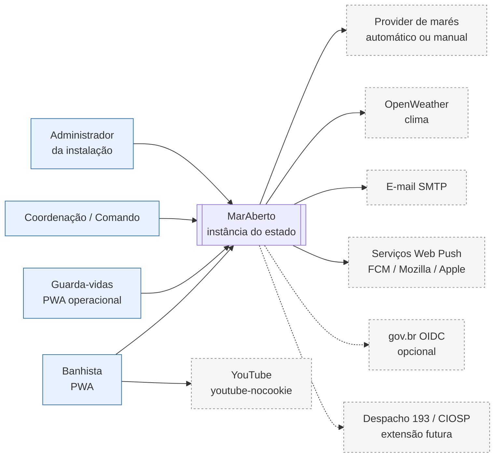
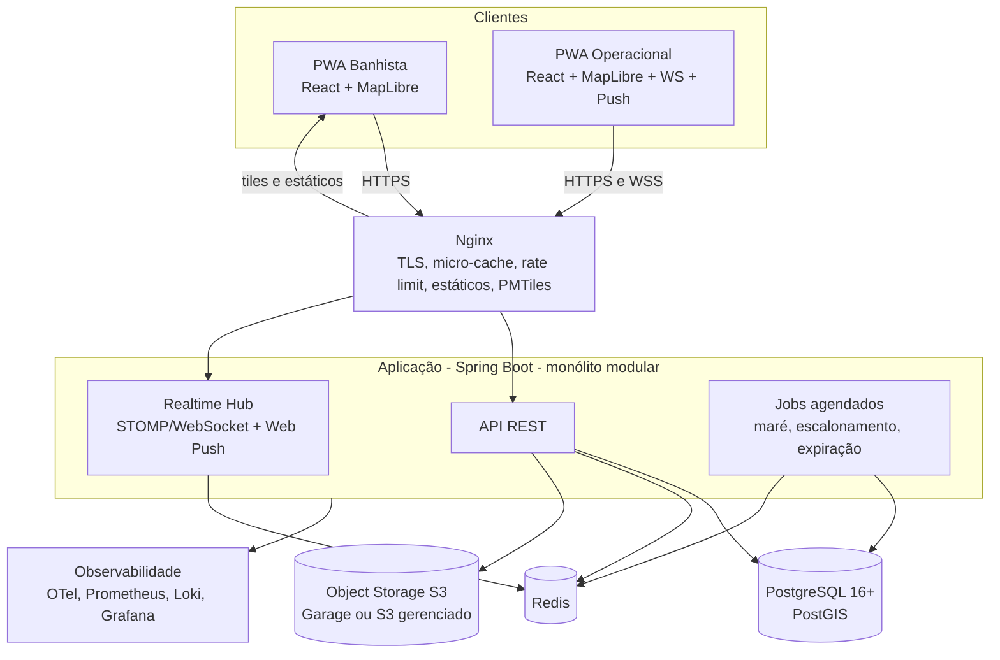
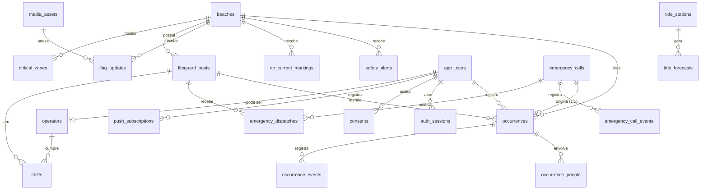
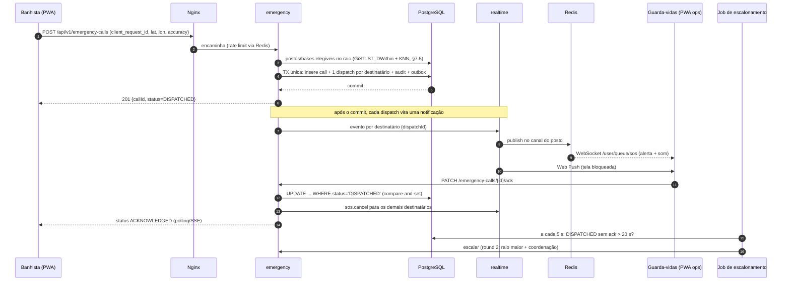
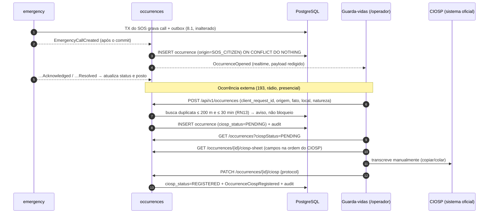

# MarAberto — Arquitetura

> **Versão:** 0.1 (rascunho) · **Data:** 2026-11-06
> **Documento relacionado:** [Requirements.md](./Requirements.md)

---

## 1. Resumo executivo

O **MarAberto** é uma plataforma open source de prevenção e resposta a afogamentos, implantável por qualquer estado. Sua carga é **média** (pico de ~6.000 conexões simultâneas, 95 % leitura), mas seu componente de **SOS é crítico para a vida**.

A arquitetura recomendada é um **monólito modular** em Java/Spring Boot, com **PostgreSQL + PostGIS** como fonte da verdade, **Redis** para cache, rate limit e fan-out de tempo real, **armazenamento de objetos compatível com S3** para fotos, **autenticação embutida no próprio sistema** (Spring Security) e **Nginx** como borda com micro-cache.

O desenho foca em três coisas:

1. **Confiabilidade do SOS**: persistência antes de notificar (Transactional Outbox), reconhecimento obrigatório, escalonamento automático, canais redundantes (WebSocket + Web Push + polling) e fallback para o 193.
2. **Absorver o pico de leitura barato**: cache HTTP/Nginx + Redis, sem WebSocket para o público.
3. **Ser fácil de adotar**: um `docker compose up`, sem componentes pesados obrigatórios, configuração regional por _Region Pack_.

> **Revisão em relação ao documento de análise inicial:** o broker de mensagens **deixa de ser obrigatório** (Kafka e RabbitMQ viram adaptadores opcionais) e o **MinIO deixa de ser o padrão** de armazenamento. Os motivos estão nas seções 3, 11 e 12.

---

## 2. Drivers arquiteturais

| #   | Driver                                        | Impacto no desenho                                                            |
| --- | --------------------------------------------- | ----------------------------------------------------------------------------- |
| 1   | SOS com p95 < 3 s e sem perda silenciosa      | Outbox, ack obrigatório, escalonamento, canais redundantes, sonda sintética.  |
| 2   | Pico sazonal de leitura (≈ 6.000 simultâneos) | Cache em camadas; leituras públicas sem estado; sem WebSocket para banhistas. |
| 3   | Rede ruim na praia                            | PWA, payload pequeno, tiles próprios, offline parcial, retries idempotentes.  |
| 4   | Adoção por estados com TI pequena             | Poucos componentes obrigatórios, Compose, perfis de implantação, runbooks.    |
| 5   | LGPD e dados de localização                   | Detecção de ocupação no cliente, sem trilhas, CPF cifrado, retenção definida. |
| 6   | Longevidade do projeto open source            | Fronteiras de módulos verificadas, ADRs, dependências com manutenção ativa.   |

---

## 3. Decisões-chave (resumo)

| ADR | Decisão                                                                                                               | Em uma frase                                                                                                                                                                    |
| --- | --------------------------------------------------------------------------------------------------------------------- | ------------------------------------------------------------------------------------------------------------------------------------------------------------------------------- |
| 001 | Monólito modular (Spring Modulith)                                                                                    | Carga média, equipe pequena, deploy simples; microserviços seriam custo sem retorno.                                                                                            |
| 002 | PostgreSQL + PostGIS como fonte única da verdade                                                                      | Geoespacial, transações e consistência forte no mesmo lugar.                                                                                                                    |
| 003 | Transactional Outbox via _event publication registry_                                                                 | Elimina _dual write_ entre banco e eventos.                                                                                                                                     |
| 004 | **Sem broker obrigatório**; RabbitMQ e Kafka como adaptadores opcionais                                               | Volume de eventos é minúsculo; cada broker é custo operacional para o estado.                                                                                                   |
| 005 | Redis obrigatório (cache, rate limit, fan-out)                                                                        | Justificado por pico de leitura e múltiplas instâncias.                                                                                                                         |
| 006 | **Armazenamento S3-compatível por porta**, com **Garage** como padrão do Compose e **S3 gerenciado** como alternativa | MinIO Community Edition foi arquivado em abril/2026; não é base segura para um projeto novo.                                                                                    |
| 007 | **Autenticação embutida** no módulo `identity` (Spring Security, JWT de vida curta + refresh com rotação, TOTP)       | Decisão do projeto: menos peças, identidade própria e independente de sistemas institucionais existentes. O risco (segurança é responsabilidade nossa) é tratado na seção 13.1. |
| 008 | Banhista com _polling_ + ETag; WebSocket só para operacionais                                                         | Leitura cacheável e barata; WS onde latência importa.                                                                                                                           |
| 009 | Tiles vetoriais próprios (PMTiles)                                                                                    | Evita depender de servidores públicos do OSM.                                                                                                                                   |
| 010 | Instância única por estado (_single-tenant_)                                                                          | Soberania de dados e simplicidade; multi-tenant fica fora do núcleo.                                                                                                            |
| 011 | Spring Boot **4.1.x** (Java 21 ou 25)                                                                                 | O Boot 3.5 teve o suporte OSS encerrado em 30/06/2026; novo projeto deve nascer na linha suportada.                                                                             |
| 013 | **Ocorrência como entidade própria** (módulo `occurrences`), criada por evento a partir do SOS e por registro manual  | O SOS é um alerta de segundos; a ocorrência é a ficha operacional e também recebe o que veio do 193 ou de fora do sistema (seção 8.7).                                          |
| 014 | **Busca tolerante a erros no PostgreSQL** (`pg_trgm`) atrás de `SearchPort`; OpenSearch opcional                      | Poucos milhares de documentos não justificam outro serviço na VM única (seção 7.10).                                                                                            |
| 015 | **Frontend _feature-based_** com fronteiras verificadas por lint                                                      | Um app, áreas lazy por perfil, sem acoplamento entre domínios (seção 6.1).                                                                                                      |
| 018 | **O PostGIS escolhe quem notificar; o broker só entrega** (dispatches por destinatário, ack por CAS, escalonamento no banco) | Filtro geográfico no broker erra fronteira de célula, não faz KNN e não acompanha o posto que se move (seção 7.13).                                                             |

### Por que não Kafka (agora)?

| Pergunta                 | Resposta                                                                                                                                                                |
| ------------------------ | ----------------------------------------------------------------------------------------------------------------------------------------------------------------------- |
| Volume justifica?        | Não. SOS: dezenas/dia; bandeiras: centenas/dia; reportes: milhares no pico. Um Postgres resolve com folga.                                                              |
| Qual o custo?            | Cluster (mínimo 3 brokers para HA), memória, expertise de operação, monitoramento de lag. Um estado pequeno raramente tem isso.                                         |
| O que perdemos sem ele?  | Quase nada no MVP: o Outbox já dá entrega _at-least-once_ e ordenação por agregado.                                                                                     |
| Quando faz sentido?      | (a) consolidar telemetria de várias instalações; (b) alimentar plataforma de dados/analytics; (c) integrar com sistemas estaduais que consomem Kafka.                   |
| Como não fechar a porta? | Os eventos já nascem como eventos de domínio; o Spring Modulith permite **externalizá-los** para Kafka/AMQP por configuração. Vira um perfil `kafka`, não um requisito. |

> Se o objetivo também for **estudo ou portfólio com Kafka**, o adaptador opcional é o lugar certo: ele agrega valor real (analytics e integração) sem impor o custo a quem só quer instalar e usar.

### Por que não manter o MinIO?

O repositório da edição comunitária do MinIO foi **arquivado em abril de 2026** e não recebe mais correções upstream. Um projeto open source que será instalado por vários órgãos não pode nascer sobre componente congelado. Por isso o código fala com **qualquer S3** através de uma porta (`ObjectStoragePort`) e o Compose traz **Garage** (leve, S3-compatível, binário único) como padrão. Quem usa nuvem pública aponta para o bucket S3 do provedor. Alternativas avaliáveis: SeaweedFS e Ceph RGW (mais peso operacional).

---

## 4. Contexto do sistema (C4 — nível 1)



---

## 5. Contêineres (C4 — nível 2)



**Componentes obrigatórios no perfil mínimo:** Nginx, aplicação, PostgreSQL/PostGIS, Redis, armazenamento S3. **Opcionais:** RabbitMQ, Kafka, stack de observabilidade dedicada, réplica de leitura.

---

## 6. Módulos do monólito

Implementados com **Spring Modulith**: cada módulo é um pacote de topo; só a API pública (`api/`) é visível aos demais; as regras são verificadas por teste (`ApplicationModules.verify()`).

> **Implementação atual (Etapa 1, 2026-11-07):** Spring Boot 3.3.4 + Spring Modulith 1.2.13 (ADR-011). A migração para Boot 4.1.x fica em issue própria. Os pacotes `oceanography` e `education` foram renomeados para `tides` e `content`, alinhando o código a esta tabela.

| Módulo        | Responsabilidade                                                                                                                    | Publica eventos                                                                | Consome                                              |
| ------------- | ----------------------------------------------------------------------------------------------------------------------------------- | ------------------------------------------------------------------------------ | ---------------------------------------------------- |
| `identity`    | Cadastro, OTP, CPF (cifrado), login, tokens, MFA (TOTP), papéis, convite de operacionais.                                           | `UserRegistered`, `OperatorInvited`                                            | —                                                    |
| `region`      | Configuração da instalação, importação de _Region Pack_.                                                                            | `RegionConfigChanged`                                                          | —                                                    |
| `beaches`     | Praias, zonas de risco permanentes e semipermanentes, fichas, GeoJSON público.                                                      | `BeachChanged`, `RiskZoneChanged`                                              | `RegionConfigChanged`                                |
| `operations`  | Postos, plantões, bandeiramento, demarcação de correntes.                                                                           | `ShiftStarted`, `ShiftEnded`, `FlagChanged`, `RipCurrentMarked`, `PostChanged` | —                                                    |
| `emergency`   | SOS: criação, despacho, ack, escalonamento, ciclo de vida.                                                                          | `EmergencyCallCreated`, `…Acknowledged`, `…Escalated`, `…Resolved`             | —                                                    |
| `occurrences` | Ocorrências: abertas a partir do SOS ou registradas manualmente (193/externas), desfecho, fila e ficha de transcrição para o CIOSP. | `OccurrenceOpened`, `OccurrenceClosed`, `OccurrenceCiospRegistered`            | `EmergencyCallCreated`, `…Acknowledged`, `…Resolved` |
| `search`      | Projeção de busca (`search_documents`) e `SearchPort`; adaptador PostgreSQL por padrão.                                             | —                                                                              | `BeachChanged`, `RiskZoneChanged`, `PostChanged`     |
| `safety`      | Reportes comunitários, quórum, moderação.                                                                                           | `ReportSubmitted`, `AlertActivated`, `AlertClosed`                             | `FlagChanged`                                        |
| `tides`       | Ingestão, previsão, sizígia, consulta.                                                                                              | `TideForecastIngested`                                                         | `RegionConfigChanged`                                |
| `content`     | CMS de vídeos e dicas.                                                                                                              | `ContentChanged`                                                               | —                                                    |
| `occupancy`   | Contagem anônima e níveis por praia.                                                                                                | `OccupancyLevelChanged`                                                        | `BeachChanged`                                       |
| `media`       | URLs pré-assinadas, saneamento (EXIF), miniaturas.                                                                                  | `MediaReady`, `MediaRejected`                                                  | —                                                    |
| `realtime`    | WebSocket, Web Push, fan-out via Redis.                                                                                             | —                                                                              | eventos de `emergency`, `operations`, `safety`       |
| `audit`       | Trilha imutável (API **síncrona**, na mesma transação).                                                                             | —                                                                              | —                                                    |
| `analytics`   | Visões agregadas, mapa de calor, dados abertos.                                                                                     | —                                                                              | `EmergencyCallResolved`, `AlertActivated`            |
| `shared`      | Kernel mínimo (tipos, erros, geoutils).                                                                                             | —                                                                              | —                                                    |

**Dependências permitidas (resumo):** `emergency → operations(api)`, `emergency → audit(api)`, `emergency → realtime(api)` (portas de publicação — hoje `RealtimePublisherPort`, no despacho do SOS `SosNotifierPort`), `occurrences → operations(api)`, `occurrences → beaches(api)`, `occurrences → audit(api)` (o `emergency` **não** depende de `occurrences`: a ligação é por evento), `safety → beaches(api)`, `safety → audit(api)`, `operations → beaches(api)`, `occupancy → beaches(api)`, `realtime →` **nenhum módulo de domínio** (consome eventos e entrega; nunca decide destinatário — §7.13). Qualquer outro acoplamento direto é violação.

> **Auditoria é chamada direta, não evento.** Um evento assíncrono pode se perder entre o commit e a escrita; a trilha de auditoria precisa estar **na mesma transação** do ato auditado.

### Estrutura de pacotes (padrão por módulo)

```
org.MarAberto.<modulo>
├── api/            # interfaces, DTOs e eventos públicos (visíveis a outros módulos)
├── application/    # casos de uso (serviços de aplicação)
├── domain/         # entidades, value objects, regras (sem Spring)
└── infra/          # JPA/JDBC, controllers REST, adaptadores (internos)
```

Pacote-base é sugestão; ajuste ao domínio da organização do projeto.

### 6.1 Estrutura do frontend (_feature-based_, ADR-015)

O frontend (`web/`) é **um único app React** com áreas carregadas sob demanda (`React.lazy`) por perfil. Substitui a ideia anterior de dois _bundles_ (`apps/public` e `apps/ops`): o público continua leve porque `/operador`, `/gestao` e `/admin` são _chunks_ que o banhista nunca baixa.

```
web/src/
├── app/                      # composição: nada de regra de negócio
│   ├── App.tsx, main.tsx, index.css
│   ├── routes.tsx            # rotas lazy + guardas por papel
│   ├── layout/               # RootLayout, AppMenu, OfflineBanner, InstallPrompt
│   └── pages/                # HomePage (compõe o mapa), AboutPage, NotFoundPage
├── shared/                   # reutilizável por qualquer módulo; nunca importa de features/ nem de app/
│   ├── components/           # Card, Badges, DemoNotice, Dialog/Sheet, Button
│   ├── lib/                  # api-client, sanitize, format, id, overlay, storage, validation primitiva
│   └── types/                # tipos primitivos (Coordinates, ApiProblem…)
└── features/                 # um domínio de negócio por pasta
    ├── map/                  # MapView, estilo, fábrica de marcadores DOM, camadas
    ├── beaches/              # busca, detalhe e BeachSheet
    ├── stations/             # postos fixos e bases móveis (StationSheet)
    ├── signals/              # sinalização/bandeiramento com foto (SignalSheet)
    ├── sos/                  # fluxo do SOS cidadão e SosFab
    ├── tides/                # tábua de marés
    ├── learn/                # guias, facade de vídeo, filtros por chip
    ├── search/               # caixa de busca e hook de resultados
    ├── auth/                 # LoginPage, sessão em memória, RequireRole
    ├── occurrences/          # lista, formulário, ficha CIOSP (usada por operator e management)
    ├── operator/             # /operador: mesa de despacho, plantão, cadastro de posto/base
    ├── management/           # /gestao: acompanhamento do campo e pendências
    └── admin/                # /admin (TI): usuários e configuração
        ├── api/              # chamadas e hooks
        ├── components/
        ├── types/            # modelos da feature
        ├── pages/
        └── index.ts          # API pública: só o que sai daqui pode ser importado por outra feature
```

**Regras (verificadas por lint no CI):**

1. Uma feature importa apenas de `shared/` e de si mesma.
2. Importação entre features só pela API pública (`index.ts`) e só nas arestas permitidas: `operator → occurrences`, `management → occurrences`, `admin → stations`, `* → auth`. Qualquer outra composição acontece em `app/` (por exemplo, `HomePage` junta `map` + `beaches` + `stations` + `signals`, passando as camadas por _props_; o `map` não conhece praia).
3. `shared/` nunca importa de `features/` nem de `app/`.
4. Tipos de domínio ficam na feature (`types/`), não num `types.ts` global. Contratos continuam `readonly`.
5. Dados de demonstração ficam em `features/<x>/api/demo-*.ts` e somem quando o endpoint real existir.

**Rotas e áreas:**

| Rota                                                    | Papel                     | Feature                                   |
| ------------------------------------------------------- | ------------------------- | ----------------------------------------- |
| `/`, `/praias`, `/mares`, `/aprender`, `/sos`, `/sobre` | público                   | `map`, `beaches`, `tides`, `learn`, `sos` |
| `/login`                                                | público                   | `auth`                                    |
| `/operador/**`                                          | `LIFEGUARD` (e acima)     | `operator`, `occurrences`                 |
| `/gestao/**`                                            | `COORDINATOR` (e `ADMIN`) | `management`, `occurrences`               |
| `/admin/**`                                             | `ADMIN`                   | `admin`                                   |

A guarda de rota no cliente é **só experiência de uso**; a autorização real é do servidor (13.2).

### 6.2 Empacotamento mobile (Capacitor, ADR-019)

O app Android/iOS é o **mesmo `web/` empacotado em WebView com Capacitor** — não há fork nem segunda base de UI. Browser, PWA instalada e app nativo compartilham as telas, as regras e o cliente HTTP; o projeto Flutter em `mobile/` está **congelado** e não é referência vigente (ADR-019).

```
web/
├── capacitor.config.ts       # appId org.maraberto.app, webDir "dist"
├── .env.capacitor.example    # VITE_API_BASE_URL absoluto e HTTPS no build nativo
├── android/                  # projeto nativo (versionado; build/ e assets copiados ignorados)
├── ios/                      # gerado só em macOS com Xcode
└── dist/                     # saída do Vite, copiada pelo `cap sync`
```

**O que muda no nativo e não pode ser esquecido:**

| Tema | Navegador/PWA | App Capacitor |
| --- | --- | --- |
| Origem | mesma origem + proxy `/api` | `https://localhost` (Android) / `capacitor://localhost` (iOS): `VITE_API_BASE_URL` **absoluto e HTTPS** |
| Sessão | cookie `HttpOnly; Secure; SameSite=Strict` na mesma origem | `CapacitorHttp` + `CapacitorCookies` (jar nativo), mantendo o cookie; nunca token em storage |
| Offline | service worker + `offline.html` | bundle local; **service worker não existe** no WKWebView |
| Alerta do SOS | popup + sirene + `showNotification` via SW | popup + sirene + **notificação nativa** (`local-notifications`; push com app fechado na ADR-018, item 6) |
| GPS / câmera / links | APIs do navegador | GPS por `@capacitor/geolocation`; `tel:193` e rota no Maps abertos pelo `Bridge` (sem plugin; câmera pendente) |
| CSP | Nginx (`web/nginx.conf`) | `<meta http-equiv="Content-Security-Policy">` no `index.html` |
| Backup | — | `android:allowBackup="false"` (o storage do WebView não vai para o backup) |

**Regra de código:** nenhuma feature importa `@capacitor/*` diretamente. Detecção de plataforma e adaptadores ficam em `shared/lib/platform.ts` (plataforma) e `shared/lib/native.ts` (plugins: GPS, notificação e keep-awake), com a implementação web como padrão em `shared/lib/geolocation.ts` e `shared/lib/pwa.ts` — assim o PWA continua funcionando sem plugin e as fronteiras da ADR-015 seguem válidas.

**Build:** `cd web && npm run cap:sync` (equivale a `npm run build:app` + `npx cap sync android`); o APK/AAB sai do Android Studio (`npm run cap:open`) ou de `web/android/gradlew assembleDebug|assembleRelease` (JDK 21 + Android SDK com platform 36). O APK **debug** já é gerado com `JAVA_HOME` no Temurin 21 e `sdk.dir` em `web/android/local.properties`; o release exige keystore. O build nativo usa `--mode capacitor`: exige `VITE_API_BASE_URL` absoluto em HTTPS (validado pelo `vite.config.ts`), injeta a CSP por `<meta>` e desliga o service worker. `cap add ios` e o build iOS exigem macOS + Xcode. Detalhes e o procedimento passo a passo ficam em `docs/Implementation.md`, Etapa 8B.

---

## 7. Modelo de dados

### 7.1 Visão geral



### 7.2 Ajustes sobre o modelo do documento inicial

| #   | Ajuste                                                                                                                          | Motivo                                                                                                               |
| --- | ------------------------------------------------------------------------------------------------------------------------------- | -------------------------------------------------------------------------------------------------------------------- |
| 1   | Remover `crowd_level` de `beaches`.                                                                                             | É dado volátil; vive em Redis e em `occupancy_snapshots` agregado.                                                   |
| 2   | Tirar bandeiras de `safety_alerts` e criar `flag_updates`.                                                                      | Bandeira tem validade, histórico e autoria próprios; misturar com alerta comunitário complica consultas e auditoria. |
| 3   | `emergency_calls` ganha `client_request_id` (único), `accuracy_m`, `version`, `acknowledged_at`, `resolved_at`, `outcome`.      | Idempotência, incerteza de GPS, concorrência otimista, métricas de tempo.                                            |
| 4   | Criar `emergency_dispatches` e `emergency_call_events`.                                                                         | Saber **quem foi notificado** e **quando**; histórico de estados.                                                    |
| 5   | `tide_forecasts` passa a ter `station_id`, `source` e `UNIQUE (station_id, forecast_timestamp, tide_type)`.                     | Ingestão idempotente; várias fontes/estações.                                                                        |
| 6   | Convenção: polígonos em `geometry(…,4326)`; pontos em `geography(Point,4326)`; distâncias **sempre** em metros via `geography`. | `ST_DWithin` em `geometry` 4326 mede graus, não metros — armadilha clássica.                                         |
| 7   | Consulta de contexto com _fallback_ por vizinho mais próximo (`<->`).                                                           | A query original não retorna nada se o usuário estiver fora de qualquer polígono de praia.                           |
| 8   | Adicionar `state_code` (UF) em `beaches`.                                                                                       | Region Pack e filtros.                                                                                               |
| 9   | Migrações com **Flyway**; ids como UUID (considerar UUIDv7 gerado na aplicação para melhor localidade de índice).               | Evolução controlada do esquema.                                                                                      |
| 10  | `emergency_calls.outcome` deixa de ser a fonte do desfecho: ele passa a viver em `occurrences`.                                 | O desfecho é um dado operacional da ocorrência (RF28) e também existe para atendimentos que nunca foram SOS.         |
| 11  | Criar `occurrences`, `occurrence_events` e `occurrence_people` (7.9).                                                           | Ocorrência própria, com origem, pendência de CIOSP e dados de pessoas cifrados.                                      |
| 12  | Criar `search_documents` com `pg_trgm` (7.10).                                                                                  | Busca tolerante a erros sem novo serviço.                                                                            |
| 13  | `lifeguard_posts` guarda `position_source` (`MANUAL`, `DEVICE_GPS`, `MAP_PICK`) e `position_accuracy_m`.                        | Cadastro com a localização atual (RF11): a acurácia diz o quanto confiar no ponto do posto.                          |

### 7.3 DDL das tabelas novas ou alteradas (essenciais)

```sql
CREATE EXTENSION IF NOT EXISTS postgis;
CREATE EXTENSION IF NOT EXISTS pgcrypto;

-- Configuração da instalação (linha única)
CREATE TABLE installation_settings (
    id            SMALLINT PRIMARY KEY DEFAULT 1 CHECK (id = 1),
    state_code    CHAR(2) NOT NULL,
    timezone      VARCHAR(50) NOT NULL,            -- ex.: 'America/Maceio'
    map_center    GEOGRAPHY(Point, 4326) NOT NULL,
    emergency_phone VARCHAR(20) NOT NULL DEFAULT '193',
    settings      JSONB NOT NULL DEFAULT '{}'::jsonb, -- parâmetros: quórum, validade da bandeira, tempos de escalonamento
    updated_at    TIMESTAMPTZ NOT NULL DEFAULT NOW()
);

-- Usuários e autenticação (embutidos no sistema)
CREATE TABLE app_users (
    id                 UUID PRIMARY KEY DEFAULT gen_random_uuid(),
    email              VARCHAR(254) NOT NULL UNIQUE,
    email_verified_at  TIMESTAMPTZ,
    password_hash      VARCHAR(255),                -- Argon2id (formato PHC); nulo até o convidado definir a senha
    cpf_cipher         BYTEA,                       -- AES-GCM; chave fora do banco
    cpf_blind_idx      BYTEA UNIQUE,                -- HMAC-SHA256(cpf) para unicidade/busca
    role               VARCHAR(20) NOT NULL,        -- BATHER, LIFEGUARD, COORDINATOR, ADMIN
    status             VARCHAR(20) NOT NULL DEFAULT 'ACTIVE', -- INVITED, ACTIVE, SUSPENDED, DISABLED
    totp_secret_cipher BYTEA,                       -- segredo TOTP cifrado
    totp_enabled_at    TIMESTAMPTZ,
    failed_login_count INT NOT NULL DEFAULT 0,
    locked_until       TIMESTAMPTZ,
    created_at         TIMESTAMPTZ NOT NULL DEFAULT NOW()
);

-- Sessões: refresh token opaco guardado apenas como hash, com rotação e detecção de reuso
CREATE TABLE auth_sessions (
    id              UUID PRIMARY KEY DEFAULT gen_random_uuid(),
    user_id         UUID NOT NULL REFERENCES app_users(id),
    family_id       UUID NOT NULL,                  -- cadeia de rotação; reuso => revoga a família inteira
    refresh_hash    BYTEA NOT NULL UNIQUE,
    user_agent_hash BYTEA,
    created_at      TIMESTAMPTZ NOT NULL DEFAULT NOW(),
    expires_at      TIMESTAMPTZ NOT NULL,
    rotated_at      TIMESTAMPTZ,
    revoked_at      TIMESTAMPTZ
);
CREATE INDEX idx_auth_sessions_family ON auth_sessions(family_id);

-- Tokens de uso único: verificação de e-mail, reset de senha, convite de operacional
CREATE TABLE one_time_tokens (
    id         UUID PRIMARY KEY DEFAULT gen_random_uuid(),
    user_id    UUID NOT NULL REFERENCES app_users(id),
    purpose    VARCHAR(20) NOT NULL,                -- EMAIL_VERIFY, PASSWORD_RESET, OPERATOR_INVITE
    token_hash BYTEA NOT NULL UNIQUE,               -- o token em si só existe no e-mail enviado
    created_by UUID REFERENCES app_users(id),
    expires_at TIMESTAMPTZ NOT NULL,
    used_at    TIMESTAMPTZ,
    created_at TIMESTAMPTZ NOT NULL DEFAULT NOW()
);

CREATE TABLE recovery_codes (
    user_id   UUID NOT NULL REFERENCES app_users(id),
    code_hash BYTEA NOT NULL,
    used_at   TIMESTAMPTZ,
    PRIMARY KEY (user_id, code_hash)
);

-- Plantões
CREATE TABLE shifts (
    id          UUID PRIMARY KEY DEFAULT gen_random_uuid(),
    operator_id UUID NOT NULL REFERENCES app_users(id),
    post_id     UUID NOT NULL REFERENCES lifeguard_posts(id),
    started_at  TIMESTAMPTZ NOT NULL DEFAULT NOW(),
    ended_at    TIMESTAMPTZ,
    location    GEOGRAPHY(Point, 4326)
);
CREATE UNIQUE INDEX uq_shift_open_per_operator ON shifts(operator_id) WHERE ended_at IS NULL;

-- Bandeiramento (histórico com validade)
CREATE TABLE flag_updates (
    id          UUID PRIMARY KEY DEFAULT gen_random_uuid(),
    beach_id    UUID NOT NULL REFERENCES beaches(id),
    post_id     UUID REFERENCES lifeguard_posts(id),
    flag        VARCHAR(20) NOT NULL,              -- GREEN, YELLOW, RED, DOUBLE_RED
    media_id    UUID,
    set_by      UUID NOT NULL REFERENCES app_users(id),
    valid_until TIMESTAMPTZ NOT NULL,
    created_at  TIMESTAMPTZ NOT NULL DEFAULT NOW()
);
CREATE INDEX idx_flag_current ON flag_updates (beach_id, created_at DESC);

-- Demarcação dinâmica de correntes
CREATE TABLE rip_current_markings (
    id          UUID PRIMARY KEY DEFAULT gen_random_uuid(),
    beach_id    UUID NOT NULL REFERENCES beaches(id),
    geometry    GEOMETRY(Polygon, 4326) NOT NULL,
    created_by  UUID NOT NULL REFERENCES app_users(id),
    valid_until TIMESTAMPTZ NOT NULL,
    created_at  TIMESTAMPTZ NOT NULL DEFAULT NOW()
);
CREATE INDEX idx_rip_geom ON rip_current_markings USING GIST(geometry);

-- SOS (substitui a versão do documento inicial)
CREATE TABLE emergency_calls (
    id                UUID PRIMARY KEY DEFAULT gen_random_uuid(),
    client_request_id UUID NOT NULL UNIQUE,        -- idempotência (duplo toque / retry)
    citizen_user_id   UUID,                        -- nulo se SOS sem conta (ver D-01)
    location          GEOGRAPHY(Point, 4326) NOT NULL,
    accuracy_m        NUMERIC(7,1),
    status            VARCHAR(20) NOT NULL,        -- DISPATCHED, ACKNOWLEDGED, EN_ROUTE, ON_SCENE, RESOLVED, CANCELLED, FALSE_ALARM
    assigned_post_id  UUID REFERENCES lifeguard_posts(id),
    outcome           JSONB,
    version           BIGINT NOT NULL DEFAULT 0,   -- lock otimista
    created_at        TIMESTAMPTZ NOT NULL DEFAULT NOW(),
    acknowledged_at   TIMESTAMPTZ,
    resolved_at       TIMESTAMPTZ
);
CREATE INDEX idx_calls_loc ON emergency_calls USING GIST(location);
CREATE INDEX idx_calls_open ON emergency_calls (created_at) WHERE status = 'DISPATCHED';

CREATE TABLE emergency_dispatches (
    call_id     UUID NOT NULL REFERENCES emergency_calls(id),
    post_id     UUID NOT NULL REFERENCES lifeguard_posts(id),
    round       SMALLINT NOT NULL DEFAULT 1,       -- 1 = primeira notificação; 2+ = escalonamento
    distance_m  INT,
    notified_at TIMESTAMPTZ NOT NULL DEFAULT NOW(),
    seen_at     TIMESTAMPTZ,
    PRIMARY KEY (call_id, post_id, round)
);

CREATE TABLE emergency_call_events (
    id        BIGSERIAL PRIMARY KEY,
    call_id   UUID NOT NULL REFERENCES emergency_calls(id),
    status    VARCHAR(20) NOT NULL,
    actor_id  UUID,
    at        TIMESTAMPTZ NOT NULL DEFAULT NOW()
);

-- Auditoria append-only com encadeamento de hash
CREATE TABLE audit_log (
    id            BIGSERIAL PRIMARY KEY,
    occurred_at   TIMESTAMPTZ NOT NULL DEFAULT NOW(),   -- UTC
    actor_user_id UUID,
    action        VARCHAR(60) NOT NULL,
    entity_type   VARCHAR(40) NOT NULL,
    entity_id     VARCHAR(64),
    device_geo    GEOGRAPHY(Point, 4326),
    payload       JSONB,
    prev_hash     BYTEA,
    hash          BYTEA NOT NULL
);
REVOKE UPDATE, DELETE ON audit_log FROM PUBLIC;          -- e do papel da aplicação
-- Em produção: particionar por mês e restringir o papel da aplicação a INSERT.

-- Maré
CREATE TABLE tide_stations (
    id        UUID PRIMARY KEY DEFAULT gen_random_uuid(),
    name      VARCHAR(100) NOT NULL,
    source    VARCHAR(30) NOT NULL,                 -- DHN_TABLE, EXTERNAL_API, HARMONIC
    location  GEOGRAPHY(Point, 4326),
    timezone  VARCHAR(50) NOT NULL
);
-- tide_forecasts: acrescentar station_id, source e UNIQUE(station_id, forecast_timestamp, tide_type)

-- Mídia, push, consentimentos
CREATE TABLE media_assets (
    id           UUID PRIMARY KEY DEFAULT gen_random_uuid(),
    object_key   VARCHAR(255) NOT NULL,
    content_type VARCHAR(60) NOT NULL,
    size_bytes   BIGINT,
    sha256       BYTEA,
    owner_id     UUID NOT NULL,
    status       VARCHAR(20) NOT NULL DEFAULT 'PENDING', -- PENDING, READY, REJECTED
    created_at   TIMESTAMPTZ NOT NULL DEFAULT NOW()
);

CREATE TABLE push_subscriptions (
    id         UUID PRIMARY KEY DEFAULT gen_random_uuid(),
    user_id    UUID NOT NULL REFERENCES app_users(id),
    endpoint   TEXT NOT NULL UNIQUE,
    p256dh     TEXT NOT NULL,
    auth       TEXT NOT NULL,
    created_at TIMESTAMPTZ NOT NULL DEFAULT NOW()
);

CREATE TABLE consents (
    user_id     UUID NOT NULL REFERENCES app_users(id),
    doc_type    VARCHAR(30) NOT NULL,               -- TERMS, PRIVACY
    version     VARCHAR(20) NOT NULL,
    accepted_at TIMESTAMPTZ NOT NULL DEFAULT NOW(),
    PRIMARY KEY (user_id, doc_type, version)
);

-- Histórico agregado de ocupação (sem identificadores)
CREATE TABLE occupancy_snapshots (
    beach_id     UUID NOT NULL REFERENCES beaches(id),
    bucket_start TIMESTAMPTZ NOT NULL,
    level        VARCHAR(20) NOT NULL,
    sample_count INT NOT NULL,
    PRIMARY KEY (beach_id, bucket_start)
);
```

> As tabelas `beaches`, `critical_zones`, `educational_videos`, `lifeguard_posts` e `safety_alerts` seguem o documento inicial, com os ajustes da seção 7.2. A tabela `event_publication` é criada pelo Spring Modulith (Outbox).
>
> A DDL acima é o **alvo**. No código atual, `emergency_calls` guarda `latitude`/`longitude` em `double precision` (ADR-012) e o ponto geográfico entra como coluna **gerada** a partir delas, com índice GiST — ver §7.12. Para a operação de campo, `shift_sessions` (§7.11) substitui `shifts`: inclui base móvel, setor, última posição e o escopo do painel. A migração `V8` já materializa `shift_sessions`, `coverage_radius_m` em postos/bases, a coluna gerada com GiST e `emergency_dispatches` com uma linha por destinatário (§7.13). O nome físico da tabela de usuários é `operational_users` (`V6`); `app_users` é o nome do modelo-alvo e aparece aqui apenas como referência conceitual.

### 7.4 Consulta de contexto do banhista (com _fallback_)

```sql
-- Praia que contém o usuário; se nenhuma, a mais próxima (KNN)
WITH me AS (SELECT ST_SetSRID(ST_Point(:lon, :lat), 4326) AS p),
inside AS (
    SELECT b.* FROM beaches b, me WHERE ST_Contains(b.boundary, me.p) LIMIT 1
),
nearest AS (
    SELECT b.* FROM beaches b, me ORDER BY b.boundary <-> me.p LIMIT 1
),
chosen AS (SELECT * FROM inside UNION ALL SELECT * FROM nearest WHERE NOT EXISTS (SELECT 1 FROM inside) LIMIT 1)
SELECT c.id, c.name, c.beach_type,
       z.name AS risk_zone_name, z.description, z.persistence
FROM chosen c
LEFT JOIN critical_zones z
       ON z.beach_id = c.id
      AND z.active
      AND z.valid_from <= now()
      AND (z.valid_until IS NULL OR z.valid_until > now())
      AND ST_Contains(z.geometry, (SELECT p FROM me));
```

### 7.5 Plantões elegíveis a um SOS (distância em metros)

Elegibilidade = **posto/base ativo** + **plantão aberto e vivo** (`shift_sessions.ended_at IS NULL` e `last_seen_at` dentro do lease) + **dentro do raio de cobertura**, limitado ao **teto de distância da instalação**. A distância é medida a partir da **posição do plantão** (`shift_sessions.last_position`), com a posição da estrutura como fallback. A regra é **notificar todos** os plantões no raio — não uma amostra dos mais próximos. Duas consultas (fixos e móveis), unidas:

```sql
WITH sos AS (
    SELECT CAST(ST_SetSRID(ST_MakePoint(:longitude, :latitude), 4326) AS geography) AS point
)
SELECT s.user_id, s.id, s.post_id, s.mobile_base_id,
       -- A distância é de quem atende, não do cadastro da estrutura.
       ST_Distance(COALESCE(s.last_position, p.location), sos.point) AS distance_m,
       -- Sem posição reportada a distância cai no cadastro da estrutura: isso é
       -- sinal, não detalhe. `stale` cobre "nunca reportou" e "reportou há muito".
       (s.last_position_at IS NULL OR s.last_position_at < :stale_before) AS position_stale
FROM lifeguard_posts p
JOIN sos ON TRUE
JOIN shift_sessions s ON s.post_id = p.id AND s.ended_at IS NULL
JOIN operational_users u ON u.id = s.user_id AND u.active
WHERE p.active
  AND s.last_seen_at >= :alive_since                    -- lease do plantão
  AND ST_DWithin(COALESCE(s.last_position, p.location), sos.point,
                 LEAST(COALESCE(p.coverage_radius_m, :default_coverage_radius_m),
                       :max_radius_m))                  -- teto de 5 km

UNION ALL

SELECT s.user_id, s.id, s.post_id, s.mobile_base_id,
       ST_Distance(COALESCE(s.last_position, b.location), sos.point) AS distance_m,
       (s.last_position_at IS NULL OR s.last_position_at < :stale_before) AS position_stale
FROM mobile_bases b
JOIN sos ON TRUE
JOIN shift_sessions s ON s.mobile_base_id = b.id AND s.ended_at IS NULL
JOIN operational_users u ON u.id = s.user_id AND u.active
WHERE b.active
  AND s.last_seen_at >= :alive_since
  AND ST_DWithin(COALESCE(s.last_position, b.location), sos.point,
                 LEAST(COALESCE(b.coverage_radius_m, :default_coverage_radius_m),
                       :max_radius_m))

ORDER BY distance_m
LIMIT :max_recipients;                                                -- teto de 50
```

- **Medir pela estrutura é bug de produto, não otimização.** O posto é um cadastro; o guarda-vidas está onde o plantão diz que está. Antes da correção, um plantão em campo a poucos metros do chamado era despachado com a distância do posto cadastrado (207 km no caso real que originou a regra) e aparecia como "mais próximo" para quem estava longe.
- **`last_position` vence `p.location`/`b.location`.** Sem posição reportada (plantão recém-aberto, ou posto fixo em que ninguém atualizou), a estrutura é o fallback — e o console mostra o aviso de que a distância vem dela.
- **Sem prefiltro espacial da estrutura.** Nenhum `ST_DWithin` constante sobre `p.location`/`b.location`: ele descartaria justamente o plantão distante do posto e perto do chamado. O conjunto varrido é o de plantões abertos (índices parciais da `V8`) com a estrutura por chave primária; com centenas de plantões abertos o custo é menor do que decidir pelo posto e errar a distância. Não existe mais `maraberto.dispatch.search-radius-m`.
- `coverage_radius_m` é **por posto/base** (ex.: 1 km em posto urbano, 3 km em trecho isolado). A coluna existe desde a `V8`; quando nula, vale `maraberto.dispatch.default-coverage-radius-m` (2 km por padrão). O raio continua sendo da estrutura: quem se desloca leva a cobertura do posto/base a que está vinculado, mas nunca além do teto da instalação.
- **Teto de distância (`maraberto.dispatch.max-radius-m`, 5 km).** O raio efetivo é `LEAST(raio da estrutura, teto)`. O cadastro pode pedir **menos**, nunca mais: um raio errado (10 km, 20 km) deixaria de ser um detalhe de configuração e passaria a chamar quem não chega a tempo — e um alerta que nunca é atendível ensina o operador a ignorar o próximo. O **KNN de fallback também é limitado pelo teto**: mais longe que isso, o chamado vai para a coordenação (RN03), não para o vizinho mais distante.
- **Plantão é um *lease*.** `last_seen_at` é renovado pelo console a cada 5 min enquanto aberto e visível (posição quando há GPS, batimento `POST …/current/heartbeat` quando não há). O filtro `last_seen_at >= :alive_since` (15 min) entra **na consulta**, então um app fechado à força deixa de ser elegível imediatamente, sem depender de job. O `ShiftIdleExpiryJob` só carimba `ended_at`/`ended_reason = 'IDLE_TIMEOUT'` com intervalo largo (10 min, índice parcial da `V9`), porque corrigir o estado é obrigação da consulta, não do agendador.
- **Um chamado, um atendente.** O ack vence por CAS e **cancela os demais despachos na mesma transação**; o frame `CANCELLED` fecha popup, sirene e notificação dos perdedores logo após o commit. Dois guarda-vidas saindo para o mesmo banhista é desperdício e risco (o posto fica descoberto); apoio extra é pedido pelo rádio, fora do sistema.
- **`position_stale` é sinal, não descarte.** Nas **duas** ramificações fica `stale` quando não há posição reportada (`last_position_at IS NULL`) **ou** quando ela é mais velha que `maraberto.dispatch.position-stale-after` (padrão 30 min). "Nunca reportou" também é stale porque a distância, nesse caso, é a do cadastro da estrutura — exatamente o caso em que dizer "de você" mentiria (o 196,4 km real era um plantão aberto sem `last_position`). O console rotula a distância como "da sua unidade" quando `position_stale` e "de você" quando não.
- **`max-recipients` é teto de segurança, não seleção.** O padrão é 50 justamente para uma instalação inteira dentro de um raio mal configurado não gerar fan-out absurdo. Não use esse valor para "escolher os 3 primeiros": todos os plantões no raio são notificados.
- `shift_sessions` tem algumas centenas de linhas abertas por instalação: a consulta usa o índice parcial de plantão aberto; **não** criar GiST em `last_position` sem um `EXPLAIN` que mostre varredura dominante (§7.6).
- Quando ninguém cai no raio, o _fallback_ é o vizinho mais próximo por KNN puro (`ORDER BY <-> LIMIT :fallback_recipients`, padrão 3, sem `ST_DWithin`); se nem isso existir, a coordenação central é notificada e a resposta orienta o 193 (RN03). O SOS nunca fica sem destinatário nem deixa de ser gravado.
- O resultado destas consultas vira **uma linha de `emergency_dispatches` por destinatário** dentro da transação do SOS (§7.13); a entrega não recalcula nada.
- Detalhes de índice, geofence e medição com `EXPLAIN` estão na §7.12.

### 7.6 Otimização de consultas, cache e idempotência (usar quando justificado)

- **Views** para projeções de leitura recorrentes (ex.: praia + zona crítica + posto), evitando repetir joins complexos na aplicação. Views comuns não materializam dados e não resolvem consultas caras.
- **Views materializadas** para agregações/relatórios caros e snapshots (ex.: ocupação por grade, resumos para o GeoJSON). Criar **índice único** para permitir `REFRESH MATERIALIZED VIEW CONCURRENTLY`; definir a estratégia de atualização (evento ou job) e aceitar a defasagem. **Não** usar para dados que exigem frescor forte, como SOS, bandeira vigente ou disponibilidade de postos.
- **`SELECT ... FOR UPDATE SKIP LOCKED`** para consumo concorrente de filas no banco (Outbox, escalonamento de SOS, notificações), com transações curtas e índice parcial no status. Não usar em leituras de usuário nem quando a ordenação/justiça da fila for crítica sem critério explícito.
- **Cache com Redis** para leituras quentes (GeoJSON, contexto da praia, bandeira vigente), em _cache-aside_ com chaves versionadas (`geo:beaches:v{n}`), TTL e invalidação por eventos (`BeachChanged`, `RiskZoneChanged`, `FlagChanged`). Proteger contra _stampede_ (single-flight/lock curto) e prever _fallback_ local se o Redis cair. **Nunca** tornar o cache fonte da verdade para SOS, ack ou escrita; o banco decide.
- **Idempotência** em toda escrita sujeita a retry/duplo toque: `client_request_id` único no SOS, `Idempotency-Key` nos endpoints de escrita, constraints únicas + `INSERT ... ON CONFLICT`, consumidores de evento idempotentes e deduplicação no Outbox. A operação repetida deve devolver o mesmo resultado, não duplicar efeitos.
- Medir antes e depois com `EXPLAIN (ANALYZE, BUFFERS)`; índices GiST/B-tree, views, cache e materializações só entram com consulta real e ganho que justifique.

### 7.7 Ingestão de delimitações de praias e setores (QGIS, KML e GeoJSON)

- **Fonte operacional:** QGIS em EPSG:4326, com a geometria validada antes de exportar. KML/KMZ serve para interoperabilidade; **GeoJSON (RFC 7946)** é o formato canônico do Region Pack e do importador (ADR-016).
- **KML não é lido pelo backend em produção.** Converter KML/KMZ para GeoJSON com `ogr2ogr` (GDAL) ou exportar direto do QGIS no pipeline de importação; evita acoplar o runtime a GeoTools/parsers XML pesados.
- **Pipeline:** QGIS → KML/GeoJSON → validação → importador → PostGIS. Reprojetar para 4326, forçar 2D, garantir `Polygon`/`MultiPolygon`, aplicar `ST_IsValid`/`ST_MakeValid`, rejeitar geometria vazia ou auto-intersectada e conferir sobreposição entre praias/setores.
- **Camadas e contrato mínimo:** `beaches` (polígono), `beach_sectors` (polígono + `beach_external_id`), `lifeguard_posts` (ponto + tipo) e `critical_zones` (polígono + risco/persistência). Toda feição tem `external_id` estável, `name` e, quando aplicável, `source`.
- **Setor é a unidade operacional.** Plantão, bandeira, ocorrência, sinalização e ocupação podem referenciar `beach_sector_id`; o escopo de autorização pode ser por setor. O setor herda a praia quando não informado e a soma dos setores não precisa cobrir 100 % da praia.
- **Precisão:** guardar a geometria completa no banco; simplificar apenas a cópia enviada ao cliente (`ST_SimplifyPreserveTopology`) e nunca alterar o dado de origem por causa do payload.
- **Importação idempotente** por `external_id` (upsert por camada), versionada e auditada, com dados em `region-packs/<uf>/`. `dry-run` obrigatório, relatório de aceitos/rejeitados e remoção de feição **nunca** automática. Não usar SQL manual em produção.
- **Proveniência:** registrar fonte, versão/data e responsável (`source`, `source_version`, `imported_at`, `imported_by`); validar contra a delimitação oficial (Marinha/DHN ou município). A delimitação do órgão é operacional e não substitui a oficial.

```sql
CREATE TABLE beach_sectors (
    id            UUID PRIMARY KEY DEFAULT gen_random_uuid(),
    beach_id      UUID NOT NULL REFERENCES beaches(id),
    external_id   VARCHAR(120) NOT NULL,
    name          TEXT NOT NULL,
    kind          VARCHAR(20),                    -- NORTH, SOUTH, CENTRAL, OTHER
    display_order INT NOT NULL DEFAULT 0,
    geometry      geometry(Polygon, 4326) NOT NULL,
    source        VARCHAR(80),
    source_version VARCHAR(40),
    imported_at   TIMESTAMPTZ,
    imported_by   UUID REFERENCES app_users(id),
    created_at    TIMESTAMPTZ NOT NULL DEFAULT NOW(),
    updated_at    TIMESTAMPTZ NOT NULL DEFAULT NOW(),
    CONSTRAINT uq_sector_external UNIQUE (external_id),
    CONSTRAINT chk_sector_geom   CHECK (ST_IsValid(geometry))
);
CREATE INDEX idx_sector_beach ON beach_sectors (beach_id);
CREATE INDEX idx_sector_geom  ON beach_sectors USING GIST (geometry);
```

- **Conversão de KML (offline):** `ogr2ogr -f GeoJSON -t_srs EPSG:4326 sectors.geojson sectors.kml`; o importador recebe GeoJSON e rejeita feições fora de praia, `external_id` duplicado ou geometria inválida.
- **Cache/busca:** a importação publica `BeachChanged`/`SectorChanged`; a projeção de busca e o GeoJSON público (Redis) são invalidados por evento, nunca por TTL curto.
- **Privacidade:** geometria de praia/setor é pública; coordenada de ocorrência e posição de operador **não** entram no GeoJSON público.

### 7.8 Persistência temporal das zonas de risco

Uma zona de risco não é necessariamente permanente. O mesmo risco (ex.: corrente de retorno) pode se manifestar de três formas, e o modelo precisa representar a diferença:

| Padrão                         | Onde ocorre                                                                                                            | Como modelar                                                                                                                             |
| ------------------------------ | ---------------------------------------------------------------------------------------------------------------------- | ---------------------------------------------------------------------------------------------------------------------------------------- |
| **Fixa/permanente**            | Píeres, molhes, quebra-mares, costões, foz de rio/canal. A estrutura física canaliza a água sempre pelo mesmo caminho. | `critical_zones` com `persistence = 'PERMANENT'`, `valid_until` nulo.                                                                    |
| **Semipermanente/topográfica** | Canais entre bancos de areia; dura dias, semanas ou meses até o relevo mudar.                                          | `critical_zones` com `persistence = 'SEMI_PERMANENT'`, `valid_from`/`valid_until` e `last_confirmed_at`; revalidar após ressacas.        |
| **Migratória/efêmera**         | Praias abertas e retas; surge, se desloca e desaparece em horas ou minutos.                                            | `rip_current_markings` (módulo `operations`), com `valid_until` curto e autoria do guarda-vidas. **Não** cadastrar como zona permanente. |

- **Visibilidade:** uma zona aparece no mapa somente quando `active`, `valid_from <= now()` e (`valid_until IS NULL OR valid_until > now()`). O predicado está em `CriticalZone.isVisibleAt` e deve ser replicado no GeoJSON e no cache.
- **Correntes efêmeras não viram polígono permanente.** Elas entram pela demarcação dinâmica (`RipCurrentMarked`) ou por reporte comunitário com quórum (`safety`), expiram sozinhas e podem ser renovadas enquanto o risco persistir.
- **Expiração:** zonas semipermanentes vencidas não são apagadas automaticamente; ficam invisíveis e entram na fila de revalidação/expurgo. Um job pode usar o índice parcial `idx_critical_zones_valid_until`.
- **Cache/GeoJSON:** a chave de cache deve considerar a janela de validade; zonas efêmeras exigem TTL curto e invalidação por `RipCurrentMarked`, enquanto permanentes só mudam com `RiskZoneChanged`.
- **Fonte da verdade:** o banco decide a janela de validade; o cache nunca mantém uma zona efêmera viva depois de `valid_until`.

### 7.9 Ocorrências (ADR-013)

```sql
CREATE TABLE occurrences (
    id                  UUID PRIMARY KEY DEFAULT gen_random_uuid(),
    number              BIGINT GENERATED ALWAYS AS IDENTITY,           -- nº interno legível
    client_request_id   UUID UNIQUE,                                   -- idempotência do registro manual
    origin              VARCHAR(20) NOT NULL,                          -- SOS_CITIZEN, CBM_193, EXTERNAL_OTHER, FIELD_ATTENDED
    emergency_call_id   UUID UNIQUE REFERENCES emergency_calls(id),    -- 1:1 quando origin = SOS_CITIZEN
    external_protocol   VARCHAR(40),                                   -- nº do 193 ou de outro canal (opcional)
    nature              VARCHAR(30) NOT NULL,                          -- RESCUE, FIRST_AID, DROWNING, MISSING_PERSON, MARINE_ANIMAL, OTHER
    status              VARCHAR(20) NOT NULL,                          -- OPEN, IN_PROGRESS, CLOSED, CANCELLED, FALSE_ALARM
    occurred_at         TIMESTAMPTZ NOT NULL,                          -- quando o FATO ocorreu (≠ created_at)
    location            GEOGRAPHY(Point, 4326),                        -- sensível
    location_accuracy_m NUMERIC(7,1),
    beach_id            UUID REFERENCES beaches(id),
    beach_sector_id     UUID REFERENCES beach_sectors(id),             -- setor operacional (ADR-016)
    reference_text      TEXT,                                          -- ponto de referência (sanitizado)
    post_id             UUID REFERENCES lifeguard_posts(id),
    summary             TEXT,                                          -- cifrado (EncryptedStringConverter)
    outcome_type        VARCHAR(30),                                   -- preenchido ao encerrar (RF28)
    outcome_notes       TEXT,                                          -- cifrado
    ciosp_status        VARCHAR(20) NOT NULL DEFAULT 'PENDING',        -- PENDING, REGISTERED, NOT_REQUIRED
    ciosp_protocol      VARCHAR(40),
    ciosp_registered_at TIMESTAMPTZ,
    ciosp_registered_by UUID REFERENCES app_users(id),
    registered_by       UUID REFERENCES app_users(id),                 -- nulo quando criada pelo sistema (SOS)
    version             BIGINT NOT NULL DEFAULT 0,
    created_at          TIMESTAMPTZ NOT NULL DEFAULT NOW(),
    updated_at          TIMESTAMPTZ NOT NULL DEFAULT NOW(),
    closed_at           TIMESTAMPTZ,
    CONSTRAINT chk_occ_sos_link CHECK (origin <> 'SOS_CITIZEN' OR emergency_call_id IS NOT NULL),
    CONSTRAINT chk_occ_place   CHECK (location IS NOT NULL OR (beach_id IS NOT NULL AND reference_text IS NOT NULL))
);
CREATE INDEX idx_occ_loc     ON occurrences USING GIST(location);
CREATE INDEX idx_occ_pending ON occurrences (occurred_at DESC) WHERE ciosp_status = 'PENDING';
CREATE INDEX idx_occ_post    ON occurrences (post_id, occurred_at DESC);

CREATE TABLE occurrence_events (               -- histórico append-only da ocorrência
    id            BIGSERIAL PRIMARY KEY,
    occurrence_id UUID NOT NULL REFERENCES occurrences(id),
    kind          VARCHAR(30) NOT NULL,        -- OPENED, STATUS_CHANGED, EDITED, LINKED, CIOSP_REGISTERED, PERSON_REVEALED
    actor_id      UUID,
    detail        JSONB,                       -- sem PII em claro
    at            TIMESTAMPTZ NOT NULL DEFAULT NOW()
);

CREATE TABLE occurrence_people (               -- tudo opcional e cifrado; sem índice de busca
    id            UUID PRIMARY KEY DEFAULT gen_random_uuid(),
    occurrence_id UUID NOT NULL REFERENCES occurrences(id),
    role          VARCHAR(15) NOT NULL,        -- VICTIM, WITNESS, REQUESTER
    name_enc      TEXT,
    age_range     VARCHAR(10),                 -- faixa, não data de nascimento
    contact_enc   TEXT,
    condition_enc TEXT,                        -- dado de saúde: sensível
    destination   VARCHAR(40)                  -- encaminhamento (hospital, liberado no local…)
);
```

**Regras do modelo**

- `emergency_call_id UNIQUE` + `INSERT … ON CONFLICT DO NOTHING` torna a criação a partir do SOS **idempotente** (o evento é _at-least-once_, seção 11).
- **`FIELD_ATTENDED`** é o atendimento feito pelo guarda-vidas **sem** chamado no 193 ou no SOS; ele registra depois, com data/hora do fato e `client_request_id` para idempotência. A origem `CBM_193` exige `external_protocol` recomendado (não obrigatório) e `EXTERNAL_OTHER` cobre rádio/presencial/outro posto.
- A restrição `chk_occ_place` impõe RN12: sem coordenada, é obrigatório informar praia + ponto de referência. `beach_sector_id`, quando houver, é o recorte operacional usado no painel da coordenação.
- Nome, contato, condição, resumo e observações usam `EncryptedStringConverter` (ADR-012). Por serem cifrados, **não** entram em `LIKE`, ordenação nem em `search_documents`; a busca de ocorrência é por número, protocolo (igualdade), praia, período e natureza.
- Detalhe de `occurrence_events.detail` e `audit_log` nunca contém PII em claro. Revelar dados de pessoas grava `PERSON_REVEALED` e uma linha de auditoria com o motivo.

### 7.10 Busca tolerante a erros (ADR-014)

```sql
CREATE EXTENSION IF NOT EXISTS pg_trgm;

CREATE TABLE search_documents (                -- projeção alimentada por eventos
    kind        VARCHAR(20) NOT NULL,          -- BEACH, POST, MOBILE_BASE, RISK_ZONE, POI
    ref_id      UUID NOT NULL,
    title       TEXT NOT NULL,                 -- como exibir
    title_norm  TEXT NOT NULL,                 -- normalizado na aplicação: NFKC, sem acento, minúsculas
    aliases_norm TEXT NOT NULL DEFAULT '',     -- apelidos e grafias comuns ("Atalaia", "Aracaju")
    location    GEOGRAPHY(Point, 4326),
    state_code  CHAR(2),
    updated_at  TIMESTAMPTZ NOT NULL DEFAULT NOW(),
    PRIMARY KEY (kind, ref_id)
);
CREATE INDEX idx_search_title ON search_documents USING GIN (title_norm   gin_trgm_ops);
CREATE INDEX idx_search_alias ON search_documents USING GIN (aliases_norm gin_trgm_ops);
```

```sql
-- consulta: normalizar a entrada na aplicação antes de enviar (:q)
SELECT kind, ref_id, title,
       GREATEST(word_similarity(:q, title_norm), word_similarity(:q, aliases_norm)) AS score
  FROM search_documents
 WHERE (:q <% title_norm OR :q <% aliases_norm)          -- usa o índice GIN
 ORDER BY score DESC, (location <-> :userPoint) ASC NULLS LAST
 LIMIT 8;
```

- **Normalização na aplicação**, não com `unaccent()` no índice (`unaccent` não é `IMMUTABLE`, o que impede usá-lo em índice sem _wrapper_). A mesma função normaliza entrada e documento.
- Entradas com menos de 3 caracteres usam prefixo (`title_norm LIKE :q || '%'`), pois trigramas funcionam mal em texto muito curto.
- O limiar de similaridade (`pg_trgm.word_similarity_threshold`, padrão 0,6) deve ser **calibrado com um conjunto de teste de grafias erradas** reais (RF37 pede ≥ 95 % no top 3).
- `SearchPort` isola o motor. Um `OpenSearchSearchAdapter` pode ser ligado por perfil sem mexer em quem consome; os critérios para fazer isso estão no ADR-014.
- Busca **no PWA offline** (praias já baixadas) pode usar um índice local pequeno gerado do mesmo `search_documents`, se o orçamento de 300 KB (RNF02) permitir.

### 7.11 Operação de campo (plantão, posição e painel da coordenação)

O painel da coordenação precisa responder "quem está trabalhando, onde e com qual volume" sem transformar o aplicativo em rastreador. A posição é **a última conhecida durante o plantão**, não um histórico de trajeto.

```sql
CREATE TABLE shift_sessions (
    id                     UUID PRIMARY KEY DEFAULT gen_random_uuid(),
    user_id                UUID NOT NULL REFERENCES app_users(id),
    post_id                UUID REFERENCES lifeguard_posts(id),
    mobile_base_id         UUID REFERENCES mobile_bases(id),
    beach_id               UUID REFERENCES beaches(id),
    beach_sector_id        UUID REFERENCES beach_sectors(id),
    started_at             TIMESTAMPTZ NOT NULL DEFAULT NOW(),
    ended_at               TIMESTAMPTZ,
    last_position          GEOGRAPHY(Point, 4326),
    last_position_at       TIMESTAMPTZ,
    last_position_accuracy_m NUMERIC(7,1),
    last_seen_at           TIMESTAMPTZ NOT NULL DEFAULT NOW(),
    CONSTRAINT chk_shift_end CHECK (ended_at IS NULL OR ended_at >= started_at)
);
CREATE UNIQUE INDEX uq_shift_open  ON shift_sessions (user_id) WHERE ended_at IS NULL;
CREATE INDEX idx_shift_open        ON shift_sessions (user_id) WHERE ended_at IS NULL;
CREATE INDEX idx_shift_scope       ON shift_sessions (beach_id, beach_sector_id, started_at DESC);
```

- `uq_shift_open` impede dois plantões abertos para o mesmo operador (§17, concorrência) e é o índice que a consulta de elegibilidade do SOS usa (§7.5).
- No código atual a tabela de usuários é `operational_users` (`V6`); o DDL acima usa `app_users`, que é o nome do modelo-alvo (§7.3).
- **A `V8` materializa esta tabela** junto de `coverage_radius_m` e do dispatch por destinatário (§7.13). Sem plantão aberto não há como saber "quem está perto", então esta é a primeira dependência do despacho do SOS. O ciclo está implementado em `operations` (`GET /api/v1/dispatch/shifts/targets`, `POST /api/v1/dispatch/shifts`, `GET /api/v1/dispatch/shifts/current`, `PUT /api/v1/dispatch/shifts/current/position`, `POST /api/v1/dispatch/shifts/current/close`).
- **Só estrutura ativa é destino de plantão.** `GET /api/v1/dispatch/shifts/targets` devolve postos fixos (com praia) e bases móveis ativos, com a posição e o raio de cobertura; o console só permite abrir plantão nessa lista. Plantão em posto/base inativo continuaria no banco e sumiria da seleção do SOS sem aviso.
- **Check-in/check-out explícito:** o operador inicia e encerra o plantão; o encerramento remove a posição da visão da coordenação (o histórico fica só como duração, sem trajeto). O `ended_reason` (`MANUAL`, `IDLE_TIMEOUT`, `LOGOUT`) separa o turno encerrado pelo próprio operador do que caiu sozinho, porque os dois casos significam coisas diferentes para a coordenação.
- **Plantão sem sinal de vida cai (`V9`).** `last_seen_at` funciona como *lease*: o console renova a cada 5 min enquanto está aberto e visível (`POST /api/v1/dispatch/shifts/current/heartbeat`, `204`, sem payload, ou a própria atualização de posição) e a elegibilidade do SOS ignora plantão cujo último sinal passou de 15 min. A expiração é **preguiçosa** — avaliada na consulta e na leitura do plantão —, e o `ShiftIdleExpiryJob` apenas carimba `ended_at`/`ended_reason` a cada 10 min nas linhas vencidas (índice parcial `idx_shift_open_last_seen`). Fechar o app à força, desligar o aparelho ou perder rede **encerra o turno**, que é o comportamento correto: um console fechado não vê o alerta (medido no emulador: app minimizado ou tela bloqueada não toca nem notifica) e um "plantão fantasma" continuaria sendo escolhido pelo PostGIS. O único custo é um batimento minúsculo a cada 5 minutos por console aberto.
- **Atualização da posição:** no início do plantão (GPS do aparelho, com ajuste manual), sob ação explícita ("atualizar minha localização") e por renovação a cada 5 min **enquanto o console está aberto e visível**, com `position_accuracy_m`. Sem _background geolocation_, sem `watchPosition` e sem persistência de coordenada no navegador — a renovação existe para a base móvel não envelhecer além de `position-stale-after` (30 min) e é, ao mesmo tempo, o sinal de vida do turno (posição e lease na mesma requisição, com jitter para não sincronizar consoles). Aba escondida não envia nada; se ficar escondida além do lease, o turno cai — e ao voltar o console revalida o plantão e avisa "encerrado por inatividade" em vez de mostrar um turno que não recebe mais chamados.
- **A posição do plantão é o ponto do despacho.** Vale para posto fixo e base móvel: o raio de cobertura é da estrutura, mas a distância medida é a de `last_position` (fallback: posição do posto/base). Um guarda-vidas em campo com o posto cadastrado a 200 km precisa ser escolhido e medido pela posição em que está, não pela ficha da estrutura (§7.5).
- **Privacidade:** `last_position` é dado sensível (RN17) — visível apenas à coordenação do escopo, nunca em listagem pública, log, cache, métrica ou exportação aberta. A posição do posto/base é pública; a do operador não.
- **Painel:** uma consulta por escopo agrega plantões abertos + última posição + contadores do dia (ocorrências por origem/status, sinalizações, pendências CIOSP). Contadores usam índices parciais (`occurred_at`, `status`) e podem virar _view_ de leitura; não usar _view materializada_ para SOS/plantão, que precisam ser frescos.
- **Escopo:** `COORDINATOR` vê praias/setores do seu escopo; `ADMIN` vê tudo; `LIFEGUARD` vê o próprio plantão e o posto.

### 7.12 Geoindexação do SOS

O SOS é o fluxo mais sensível a latência (RNF01: p95 < 3 s) e o único que **escolhe destinatários por posição**. Geoindexação aqui não é "criar índice espacial em tudo": é garantir que as consultas que filtram por área usem GiST e que as que não filtram continuem em B-tree. A decisão está registrada na [ADR-017](adr/017-geoindexacao-do-sos.md).

| Consulta do caminho de SOS                                   | Coluna indexada                                                          | Índice            | Operador espacial                             |
| ------------------------------------------------------------ | ------------------------------------------------------------------------ | ----------------- | --------------------------------------------- |
| Plantões elegíveis no raio do chamado (§7.5, RF07/RF21)       | `shift_sessions.last_position` (fallback: `lifeguard_posts.location`) com plantão aberto | **B-tree parcial** (`V8`) | `ST_DWithin` sobre `geography` (sem GiST) |
| Geofence: o chamado caiu dentro da praia (+ margem)?          | `beaches.boundary` — `geometry(Polygon,4326)`                             | **GiST** (V1)     | `ST_Contains` / `ST_DWithin` sobre `geography` |
| Zona de risco no ponto do chamado (contexto do alerta)        | `critical_zones.geometry` — `geometry(Polygon,4326)`                       | **GiST** (V1)     | `ST_Contains`                                 |
| Chamados recentes numa área (dedupe, painel, calor por trecho) | `emergency_calls.location` — derivada de `latitude`/`longitude`            | **GiST** (V8)      | `ST_DWithin` + janela de tempo                |
| Fila de chamados sem ack (escalonamento, §8.1)                | `emergency_calls.created_at` com filtro de `status`                        | B-tree **parcial** | — (não é consulta espacial)                   |

**Coluna geográfica derivada.** A verdade continua em `latitude`/`longitude` (`double precision`), porque despacho e geofence precisam do valor exato e a ADR-012 veda cifrar a mesma coluna usada para consulta espacial. Em vez de duplicar a escrita (e arriscar divergência), o banco deriva o ponto:

```sql
-- PostGIS: ST_MakePoint(longitude, latitude) — nesta ordem. Trocar os dois é o
-- erro clássico que joga o chamado no oceano.
ALTER TABLE emergency_calls
    ADD COLUMN location GEOGRAPHY(Point, 4326)
    GENERATED ALWAYS AS (
        ST_SetSRID(ST_MakePoint(longitude, latitude), 4326)::geography
    ) STORED;

CREATE INDEX idx_emergency_calls_location
    ON emergency_calls USING GIST (location);
```

- `ST_MakePoint`, `ST_SetSRID` e o cast para `geography` são `IMMUTABLE`, requisito de coluna gerada — validado em PostgreSQL 16 + PostGIS: com a coluna e o índice criados em transação revertida sobre a tabela real, o `EXPLAIN (ANALYZE, BUFFERS)` mostrou `Index Scan using idx_emergency_calls_location` com `Index Cond: (location && _st_expand(...))`.
- Nada muda no ORM: a coluna não é mapeada, não é escrita pela aplicação e não aparece em DTO.
- `geography` e não `geometry`: `ST_DWithin` sobre `geometry` em 4326 mede **graus**, não metros (§7.2, item 6).

**Plantões elegíveis (raio em metros, todos os plantões no raio).**

```sql
WITH sos AS (
    SELECT CAST(ST_SetSRID(ST_MakePoint(:longitude, :latitude), 4326) AS geography) AS point
)
SELECT s.id,
       ST_Distance(COALESCE(s.last_position, p.location), sos.point) AS distance_m
FROM shift_sessions s
JOIN sos ON TRUE
JOIN lifeguard_posts p ON p.id = s.post_id AND p.active
WHERE s.ended_at IS NULL
  AND ST_DWithin(COALESCE(s.last_position, p.location), sos.point,
                 COALESCE(p.coverage_radius_m, 2000));
```

- **Sem GiST nesta consulta, de propósito.** O predicado é sobre `COALESCE(last_position, location)` — expressão que nenhum índice espacial da estrutura atende. Quem seleciona o conjunto é o índice **parcial** de plantão aberto (`idx_shift_post_open`/`idx_shift_base_open`, `V8`), com a estrutura por chave primária. Com centenas de plantões abertos por instalação isso é barato; medir antes de "otimizar" com GiST em `last_position` (§7.6).
- **Prefiltro espacial da estrutura seria errado.** Um `ST_DWithin(p.location, …)` constante descarta o plantão cujo posto está longe e cujo operador está no local do chamado — exatamente o caso real que fez um chamado a poucos metros aparecer com 207 km. O envelope `maraberto.dispatch.search-radius-m` foi removido junto com o prefiltro.
- Se nenhum plantão estiver no raio, o _fallback_ é KNN puro (`ORDER BY COALESCE(last_position, location) <-> point LIMIT :fallback_recipients`, padrão 3, sem `ST_DWithin`): o chamado nunca fica sem destinatário. O KNN também ordena sobre a expressão, sem índice.
- `coverage_radius_m` é por posto (coluna da `V8`); nulo cai no raio padrão `maraberto.dispatch.default-coverage-radius-m`. A coluna e a coluna gerada de `emergency_calls` entraram na mesma migração (`V8`).
- `max-recipients` (padrão 50) é **teto de segurança** do `INSERT`, não critério de escolha: todos os plantões no raio recebem despacho.

**Medição (PostgreSQL 16 + PostGIS 3.4, tabela sintética).**

| Cenário | Consulta | Plano | Tempo |
| ------- | -------- | ----- | ----- |
| 5.000 postos | `ST_DWithin` com `COALESCE(coverage_radius_m, …)` por linha (desenho antigo, decidindo pelo posto) | `Seq Scan`, 76 linhas | **14,3 ms** |
| 5.000 postos | prefiltro constante de 10 km + raio real (desenho antigo) | `Index Scan` no GiST | **1,7 ms** |
| 20.000 posts, 20.000 usuários, 196 plantões | consulta completa (`posts → shifts → users`) | `Nested Loop` a partir do GiST | **8,0 ms** |
| 20.000 posts, 3.185 plantões | consulta completa | `Bitmap Index Scan` no GiST | **16,6 ms** |

As duas primeiras linhas são o desenho **anterior**, que decidia pelo posto: serviram para justificar o prefiltro constante e continuam aqui como registro. A consulta atual parte de `shift_sessions` e faz o join por PK, então o plano dela precisa ser remedido com o volume real de plantões abertos — o custo absoluto esperado é baixo (centenas de linhas), mas a regra da §7.6 continua valendo: `EXPLAIN (ANALYZE, BUFFERS)` antes de qualquer índice novo.

**Chamados recentes na área** (dedupe de duplo toque, painel da coordenação, calor por trecho):

```sql
SELECT id, status, created_at
FROM emergency_calls
WHERE created_at >= NOW() - INTERVAL '30 minutes'
  AND ST_DWithin(location, :sos_point::geography, 300)
ORDER BY created_at DESC
LIMIT 20;
```

A janela de tempo reduz o conjunto e o GiST resolve o raio; o plano real (medido) usa `Index Scan using idx_emergency_calls_location` — não existe índice parcial que sirva para `created_at` sozinho, então a ordem dos predicados é decisão do planner, sempre conferida com `EXPLAIN`.

**Regras de uso**

- **Geofence não bloqueia o SOS.** Fora da praia ou sem permissão de localização, o chamado é gravado e despachado do mesmo jeito; o resultado do `ST_Contains` só marca `outside_area` para triagem e priorização. Gate de geofence contraria a ADR-001 e o RNF01.
- **Sem índice espacial onde não há consulta espacial.** Busca por `id`, `client_request_id` ou `status` é B-tree; um GiST em ponto de tabela escrita uma vez e lida por chave só custa escrita e _bloat_.
- **Medir antes de criar.** Toda consulta acima entra com `EXPLAIN (ANALYZE, BUFFERS)` no PR; sem plano usando o índice e ganho medido, o índice não entra (§7.6).
- **Manutenção.** `emergency_calls` é tabela de alto volume e pouca atualização: monitorar _bloat_ do GiST e revisar o índice se ele não for usado por nenhuma consulta real (`pg_stat_user_indexes.idx_scan`).
- **Privacidade.** A coluna derivada não amplia exposição: sai do mesmo dado já armazenado e herda a restrição de `latitude`/`longitude` (ADR-012) — nunca em listagem pública, GeoJSON, log, cache, métrica ou exportação. Índice não é superfície de API.
- **Estado atual:** a `V8` adiciona a coluna gerada `location` e o GiST `idx_emergency_calls_location`, já usados pela consulta de elegíveis (`operations.infra.JdbcEligibleRespondersRepository`), que roda na transação do SOS.

### 7.13 Despacho do SOS: quem notificar e como entregar

São **duas decisões diferentes**, e misturá-las é a origem da maior parte dos erros de despacho:

| Pergunta                                    | Quem responde                                          | Onde vive                             |
| ------------------------------------------- | ------------------------------------------------------ | ------------------------------------- |
| Quem deve ser notificado neste chamado?     | **PostGIS** (verdade única, por chamado)               | `emergency_dispatches` por destinatário |
| Como a mensagem chega até essa pessoa?      | Transporte (STOMP, Web Push, RabbitMQ opcional)         | porta `SosNotifierPort` em `realtime`  |
| Quem assumiu o chamado?                     | Banco, por _compare-and-set_                            | `emergency_calls` + `emergency_dispatches` |
| Quem é notificado se ninguém assumir?       | Banco, por job de escalonamento (round 2)               | índice parcial `idx_emergency_calls_open` |

**Regra dura:** o broker **não** filtra geografia. Routing key por geohash/célula erra a fronteira da célula, não acompanha raio por posto, não sabe que a base móvel se deslocou e não tem KNN de fallback (ADR-018). O filtro espacial fica em um lugar só: a consulta da §7.5, dentro da transação do SOS.

```sql
-- V8 (aplicada): emergency_dispatches deixa de ser "um pendente por chamado"
-- e passa a ser a prova de notificação, uma linha por destinatário.
-- A §7.3 já previa uma linha por posto (post_id); os nomes físicos seguem a V3
-- (emergency_call_id) e ganham recipient_* porque base móvel e operador também recebem.
ALTER TABLE emergency_dispatches
    ADD COLUMN round              SMALLINT NOT NULL DEFAULT 1,
    ADD COLUMN recipient_post_id  UUID REFERENCES lifeguard_posts(id),
    ADD COLUMN recipient_base_id  UUID REFERENCES mobile_bases(id),
    ADD COLUMN recipient_user_id  UUID REFERENCES operational_users(id),
    ADD COLUMN distance_m         NUMERIC(8,1),
    ADD COLUMN position_stale     BOOLEAN NOT NULL DEFAULT FALSE,
    ADD COLUMN notified_at        TIMESTAMPTZ,
    ADD COLUMN acknowledged_at    TIMESTAMPTZ,
    ADD COLUMN cancelled_at       TIMESTAMPTZ;

-- a V3 é imutável; o dispatch antigo (sem destinatário) é dado de desenvolvimento
ALTER TABLE emergency_dispatches DROP COLUMN assigned_post_id;
ALTER TABLE emergency_dispatches
    ADD CONSTRAINT ck_emergency_dispatches_recipient CHECK (
        num_nonnulls(recipient_post_id, recipient_base_id, recipient_user_id) >= 1)
    NOT VALID;

CREATE UNIQUE INDEX uq_emergency_dispatches_recipient
    ON emergency_dispatches (emergency_call_id, round,
                             COALESCE(recipient_post_id, recipient_base_id, recipient_user_id));
CREATE INDEX idx_emergency_dispatches_pending
    ON emergency_dispatches (created_at) WHERE status = 'PENDING';
CREATE INDEX idx_emergency_dispatches_unacked
    ON emergency_dispatches (created_at) WHERE status IN ('PENDING', 'NOTIFIED');

-- colunas de ciclo de vida que o ack precisa (alvo da §7.3)
ALTER TABLE emergency_calls
    ADD COLUMN assigned_post_id UUID REFERENCES lifeguard_posts(id),
    ADD COLUMN acknowledged_at  TIMESTAMPTZ,
    ADD COLUMN version          BIGINT NOT NULL DEFAULT 0;
```

O `NOT VALID` da constraint de destinatário é deliberado: a `V3` já está aplicada e pode conter despachos antigos sem destinatário em bancos de desenvolvimento. A regra vale para toda linha nova e pode ser validada depois de uma limpeza.

- **Seleção dentro da transação do SOS.** A consulta da §7.5 roda em milissegundos e o `INSERT` de um despacho por plantão elegível é barato; o custo de não fazer isso é notificar depois, fora da verdade, e não conseguir provar quem foi avisado. **Todos os plantões abertos dentro do raio recebem despacho** (o teto `max-recipients=50` existe só para raio mal configurado); o KNN de fallback é limitado (`fallback-recipients=3`) porque ali é degradação, não a regra. A chamada é registrada de qualquer forma: falha da consulta espacial cai no KNN puro e, no limite, na coordenação (RN03). **A geoindexação nunca bloqueia o salvamento do SOS.** A seleção roda em `REQUIRES_NEW`: um erro de SQL nela não aborta a transação que gravou o chamado.
- **Um evento de outbox por destinatário**, com `messageId = dispatchId`. Reenviar o mesmo `dispatchId` não duplica alerta: o consumidor é idempotente por `dispatchId` e o console deduplica por `callId`. A outbox usa lease (`claimed_at`, `maraberto.emergency.outbox.claim-lease`): reivindicar, publicar e marcar acontecem em transações curtas, então a publicação nunca segura o lock das linhas.
- **Ack por _compare-and-set_:** `UPDATE emergency_calls SET status = 'ACKNOWLEDGED', assigned_post_id = ?, version = version + 1 WHERE id = ? AND status = 'DISPATCHED'`. O primeiro vence; os demais recebem `409` com o tipo `call-already-acknowledged`. Quem recebeu o alerta mas perdeu a corrida também recebe `409`; `403` (`call-not-assigned`) é só para quem nunca foi despachado. O ack fecha `acknowledged_at` no vencedor, cancela os demais despachos e publica o cancelamento após o commit.
- **Assumir não apaga o chamado.** `GET /api/v1/dispatch/calls` é a fila de disputa (só `DISPATCHED` com o despacho em `PENDING`/`NOTIFIED`); `GET /api/v1/dispatch/calls/assigned` devolve o **atendimento em curso** do operador (`c.status IN ('ACKNOWLEDGED', 'EN_ROUTE', 'ON_SCENE')` e `d.status = 'ACKNOWLEDGED'`), com `acknowledgedAt` e a mesma coordenada restrita. É essa rota que mantém a localização do banhista na mesa depois do ack: o console mostra a **rota até o banhista** (deep link `https://www.google.com/maps/dir/?api=1&destination=lat,lon`, aberto só no clique, `rel="noreferrer"`) e é dela que nascerá a ocorrência operacional (`occurrences`, ADR-013). Sem isso, o endereço do chamado desapareceria no instante em que alguém o assume — e a ficha do CIOSP perderia a referência.
- **Distância atual, não a da abertura.** O `distance_m` do despacho é a foto do instante do SOS; depois do ack o guarda-vidas se desloca. Por isso `/calls/assigned` também devolve `currentDistanceMeters` (`ST_Distance(sh.last_position, c.location)` da **última posição do plantão** até o ponto do banhista), `currentPositionAt` e `currentPositionStale` (mesmo `maraberto.dispatch.position-stale-after`). O console reconcilia de 10 em 10 s e mostra a distância em destaque ("Distância agora"), com a hora da posição — é o que permite decidir entre deslocamento **a pé ou de veículo**. Sem posição no plantão, a distância da abertura é o fallback explícito ("na abertura do chamado"); posição desatualizada é avisada, nunca apresentada como "de você".
- **Coordenada só em rota autenticada e só por gesto.** O frame STOMP, o log, a outbox e a notificação continuam sem coordenada; o ponto chega por `/calls` e `/calls/assigned` (destinatário + papel) e só sai do navegador para o app de mapas quando o operador toca em "Abrir rota". O console avisa isso na própria ficha.
- **Abandonar o atendimento não é ack.** Ainda não há transição para `RESOLVED`/`FALSE_ALARM` a partir do console; o atendimento em curso permanece na mesa até a feature de ocorrências concluí-la. Não existe endpoint para "sumir" com o chamado.
- **Escalonamento no banco, não no broker.** Job `@Scheduled` + ShedLock, `FOR UPDATE SKIP LOCKED` sobre `idx_emergency_calls_open`: `DISPATCHED` sem ack por N segundos (padrão 20 s) → round 2 (raio maior, postos de apoio e coordenação) → `EmergencyCallEscalated`. Mensagem com _delay_ no Rabbit seria estado invisível: não aparece no painel, não sobrevive a _restart_ limpo e não é auditável.
- **Canais redundantes e independentes:** destino STOMP por usuário, Web Push e _polling_ de reconciliação (`GET /api/v1/dispatch/calls` a cada 10 s). Qualquer um sozinho tem de entregar; **nenhum** é fonte da verdade.
- **Autenticação do WebSocket:** o JWT é validado no frame `CONNECT` (`StompAuthenticationInterceptor`, com `identity.api.AccessTokenVerifier`) e a entrega é por usuário. O cliente assina `/user/queue/sos`; o servidor publica em `/queue/sos` via `convertAndSendToUser`. O tópico aberto `/topic/operational.emergency.calls` foi **removido** — sem autorização no socket, "notificar só os próximos" é cosmético.
- **Porta, não acoplamento:** `realtime.api.SosNotifierPort` com adaptadores `StompSosNotifier` (padrão) e `AmqpSosNotifier` (perfil `rabbit`). O `emergency` não importa `realtime` além da porta, e o `@Externalized` do Spring Modulith **não** é usado no SOS (a outbox cifrada própria já é o registro de publicação; ter as duas duplicaria a semântica).

**Publicação da outbox com broker externo.** O `publishPending` reivindica as linhas com lease em uma transação curta, publica **fora** dela e marca `PUBLISHED` em outra transação curta, por `id` e com checagem de status. Com o perfil `rabbit` (passo 5) entram publisher confirms + `mandatory`; a semântica continua _at-least-once_ e, sem confirm, o evento fica `PENDING` e o sweep reenvia.

| Item                | Proposta                                                                   | Por quê                                                                    |
| ------------------- | -------------------------------------------------------------------------- | -------------------------------------------------------------------------- |
| Exchange            | `maraberto.emergency` (topic, durable)                                      | Separa o domínio de emergência do resto.                                   |
| Routing keys        | `sos.notify` e `sos.cancel`                                                 | Semânticas e estáveis; destinatários vão no corpo, já resolvidos pelo banco |
| Filas               | `q.sos.realtime`, `q.sos.push` (+ `*.parking`), DLX `maraberto.emergency.dlx` | Um consumidor por papel; sem uma fila por posto                            |
| Mensagem            | persistente, `messageId = dispatchId`, só ids (`callId`, `dispatchId`, `recipientUserId`, `postId`/`baseId`, `round`) | Sem coordenadas, sem nome de vítima, sem `clientRequestId`                 |
| Consumidor          | ack manual, prefetch baixo, idempotente por `dispatchId`, retry com TTL e DLQ | Reprocessamento seguro e falha visível                                     |
| Contingência        | Rabbit fora → evento `PENDING` + sweep; STOMP direto e polling seguem        | O broker é perfil opcional (ADR-004): nenhum canal pode ser obrigatório     |

- **Teto de distância da notificação (2026-11-11):** `maraberto.dispatch.max-radius-m` (5 km) limita o raio efetivo de qualquer posto/base (`LEAST(raio, teto)`) e também o KNN de fallback. Fora do teto, o chamado vai para a coordenação em vez de acordar um guarda-vidas que não chega a tempo.
- **Estado da implementação (2026-11-11):** passos 1–4 concluídos — `V8` aplicada (`shift_sessions`, `coverage_radius_m`, coluna gerada + GiST, dispatch por destinatário), consulta de elegíveis em `operations.infra.JdbcEligibleRespondersRepository` (todos os plantões no raio, com a **posição do plantão** decidindo a distância e a estrutura só como fallback; KNN de fallback; `position_stale` para posto e base móvel, inclusive quando nunca reportaram), despacho na transação do SOS com um evento de outbox por destinatário, STOMP autenticado por JWT no `CONNECT` e ack por CAS com cancelamento dos demais. No frontend, o console do operador (`/operador`) consome `GET /api/v1/dispatch/calls`, assume por `POST …/ack` (tratando `409`/`403`), assina `/user/queue/sos` por STOMP, reconcilia por _polling_ de 10 s e abre **popup, sirene e notificação do sistema** ao receber o despacho; o chamado assumido continua na mesa em "Em atendimento por você" (`GET …/calls/assigned`) com rota até o banhista e **distância agora** (calculada da última posição do plantão, com hora da posição, para decidir entre a pé e veículo), e o check-in de plantão exige a posição do aparelho (sem ela o despacho mede pelo cadastro da estrutura). Faltam: perfil `rabbit` com confirms/DLQ, Web Push com o app fechado, job de escalonamento (round 2), métricas, sonda e k6, e a conclusão do atendimento (`RESOLVED`) pela ocorrência. Testes de elegibilidade: `SosDispatchEligibilityTests`; ack e atendimento em curso: `EmergencyDispatchAckTests`.
- **Ordem de implementação:** (1) `V8` com `shift_sessions`, `coverage_radius_m`, coluna gerada + GiST e dispatch por destinatário — **feito**; (2) consulta de elegíveis com `EXPLAIN (ANALYZE, BUFFERS)` no PR — **feito**; (3) dispatch na transação + fan-out STOMP autenticado, **sem Rabbit** — **feito**; (4) ack por CAS e cancelamento — **feito**; (5) perfil `rabbit` com confirms e Testcontainers; (6) Web Push e escalonamento; (7) métricas, sonda e k6. Cada passo entra com a documentação no mesmo PR. Detalhes e alternativas na [ADR-018](adr/018-selecao-de-destinatarios-e-entrega-do-sos.md).
- **Métricas do despacho:** `sos_time_to_notify_seconds` (do commit à notificação), `sos_unacked_current`, `sos_dispatches_by_round_total`, `sos_dispatch_without_recipient_total` (fallback acionado) e, no perfil `rabbit`, profundidade de DLQ e taxa de retry.

---

## 8. Fluxos críticos

### 8.1 SOS (caminho crítico)



**Pontos de projeto**

1. **Persistir antes de notificar.** O 201 só volta depois do commit. Se o app cair em seguida, o Outbox republica o evento na reinicialização.
2. **Idempotência.** `client_request_id` evita SOS duplicado por duplo toque ou retry de rede; `dispatchId` evita alerta duplicado no console.
3. **Ack por _compare-and-set_.** `UPDATE emergency_calls SET status='ACKNOWLEDGED', assigned_post_id=?, version=version+1 WHERE id=? AND status='DISPATCHED'` — o primeiro posto a assumir vence; os demais recebem "já assumido" e o evento `sos.cancel`. Sem lock longo, sem corrida.
4. **Escalonamento durável.** Job (com ShedLock para múltiplas instâncias) consulta o índice parcial `idx_emergency_calls_open`. Sem dependência de timer em memória nem de fila com _delay_.
5. **Canais redundantes.** WebSocket, Web Push e _polling de reconciliação_ (`GET /operations/sos/open` a cada 10 s no console). Qualquer um sozinho entrega.
6. **Cliente honesto.** Se o POST não for confirmado em ~5 s, o app mostra **"Não foi possível enviar — ligue 193"** com botão de chamada. Nunca exibir "socorro a caminho" sem ack.
7. **Anti-abuso.** Redis (token bucket) limita SOS por usuário/dispositivo; a geofence marca chamados fora da praia (+ margem) para triagem e priorização — sem bloquear o envio.
8. **Geoindexação.** A escolha dos postos usa GiST sobre `geography` (`ST_DWithin` + KNN), a geofence usa `ST_Contains` sobre o polígono da praia e o painel usa a coluna derivada de `emergency_calls` — ver §7.12. Índice espacial **não** entra no caminho crítico: a geofence marca `outside_area` para triagem, mas nunca impede gravar e despachar o chamado.
9. **Quem escolhe é o banco.** A lista de destinatários é materializada em `emergency_dispatches` dentro da transação; o broker só entrega (§7.13, ADR-018). Se a consulta espacial falhar, o chamado é gravado com fallback KNN e coordenação — **nunca** por filtro no broker ou no cliente.
10. **Sem ninguém no raio.** KNN puro escolhe os mais próximos; sem nenhum plantão aberto, a coordenação é notificada e a resposta orienta o 193 (RN03). Um SOS jamais fica sem destinatário registrado.

### 8.2 Bandeiramento

1. Guarda-vidas autenticado lança a bandeira (`POST /flags`), com foto opcional (já enviada via URL pré-assinada).
2. Transação grava `flag_updates` + auditoria + evento `FlagChanged`.
3. Listener invalida `flag:current:{beachId}` no Redis e faz _write-through_ do novo valor.
4. Banhistas veem a mudança em até 60 s (TTL do micro-cache + ETag). Operacionais veem imediatamente por WebSocket.
5. **Expiração:** a UI compara `valid_until` com o relógio do servidor; vencida → "desatualizada" (RN01).

### 8.3 Reporte comunitário e quórum

1. `POST /reports` (usuário autenticado; rate limit 5/h).
2. Em uma transação, busca reportes do mesmo tipo em raio de 100 m e 30 min:

```sql
SELECT COUNT(DISTINCT created_by_user_id)
FROM safety_alerts
WHERE alert_type = :type
  AND created_at > NOW() - INTERVAL '30 minutes'
  AND ST_DWithin(location, :point::geography, 100)
  AND status IN ('PENDING_APPROVAL','ACTIVE');
```

3. Se `≥ 3`, promove os alertas a `ACTIVE` e emite `AlertActivated`.
4. **Concorrência:** dois reportes simultâneos podem não "ver" um ao outro. Solução: `pg_advisory_xact_lock(hash(beach_id, alert_type))` no início da transação — barato e suficiente neste volume.
5. **Sybil/abuso:** exigir conta, limitar por usuário, e moderador pode reverter alertas por quórum.

### 8.4 Ingestão de maré

1. Job `@Scheduled(cron = "0 5 0 * * *", zone = "<fuso da instalação>")`.
2. `TideProvider` (porta) com adaptadores: **cadastro manual autorizado**, **importação de tábuas oficiais (DHN)**, **API externa** e, opcionalmente, **previsão harmônica** a partir de constantes da estação.
3. Valida (alturas plausíveis, ordem alternada preamar/baixa-mar) e faz _upsert_ idempotente em `tide_forecasts` para os próximos 7+ dias.
4. Calcula `is_spring_tide` pela amplitude/fase lunar (RN07).
5. Atualiza o Redis. Falha do provedor → **mantém dados do banco** e dispara alerta se restarem < 48 h de previsão.
6. Circuit breaker e timeout curtos no adaptador externo.

### 8.5 Ocupação (privacidade por desenho)

1. O cliente baixa o GeoJSON das praias (cacheado, ETag) e **compara localmente** a posição com o polígono.
2. Se estiver dentro e o app em primeiro plano, envia a cada ~5 min `POST /occupancy/heartbeat {beachId, token}`; `token` é aleatório, **gerado no dispositivo e rotacionado diariamente**.
3. No servidor: `ZADD occ:{beachId} <agora> sha256(token + salt_do_dia)`; `ZREMRANGEBYSCORE` remove > 15 min; `ZCARD` dá a contagem.
4. Nível = limiares por praia; abaixo da amostra mínima _k_ → "dados insuficientes".
5. **Limitações assumidas:** o servidor não consegue verificar a posição enviada pelo cliente (o dado é indicativo, não pericial); o IP **não é registrado** nesses endpoints (configuração do Nginx).

### 8.6 Upload de foto

1. Cliente pede `POST /media/upload-url` (tipo e tamanho declarados).
2. API devolve **URL pré-assinada** curta (5 min), com `Content-Type` e tamanho máximos amarrados; registra `media_assets` em `PENDING`.
3. Cliente envia direto ao armazenamento.
4. Evento de upload (ou _callback_ da API) dispara o **saneamento**: valida _magic bytes_, remove EXIF/GPS, redimensiona, gera miniatura → `READY` (ou `REJECTED`).
5. Só mídias `READY` são servidas.

### 8.7 Ocorrências: do SOS e de fora do sistema até o CIOSP



**Pontos de projeto**

1. **O SOS não espera a ocorrência.** A criação é por evento, depois do commit do SOS. Se o `occurrences` estiver lento ou falhar, o alerta chega do mesmo jeito (P1, RNF01).
2. **Nenhuma ocorrência de SOS fica sem registro.** Se o listener falhar, o Outbox reenvia; como rede de segurança, um job (ShedLock) cria a ocorrência de qualquer `emergency_calls` sem par com mais de 1 min e emite alerta se achar algum.
3. **Idempotência dos dois lados:** `emergency_call_id UNIQUE` no SOS; `client_request_id` no registro manual (duplo toque em tela de rede ruim).
4. **Duplicata é aviso.** O guarda-vidas decide entre vincular ao registro existente (`LINKED`) ou criar outro. Bloquear seria pior que duplicar quando há vítima.
5. **Sem integração com o CIOSP (D-07).** O sistema monta a ficha e controla a pendência. O campo `ciosp-sheet` é um modelo de leitura, e os rótulos e a ordem vêm de configuração da instalação (cada CBM tem seu formulário).
6. **Escopo de acesso (RN15):** guarda-vidas veem ocorrências do seu posto/praia; coordenação, todas. Dados de pessoas vêm mascarados; revelar grava `PERSON_REVEALED` + auditoria.
7. **Estados:** a ocorrência de SOS segue o ciclo do SOS (`DISPATCHED`→`OPEN`, `ACKNOWLEDGED`/`EN_ROUTE`/`ON_SCENE`→`IN_PROGRESS`, `RESOLVED`→`CLOSED`, `FALSE_ALARM`, `CANCELLED`); a externa nasce `OPEN` ou `CLOSED` (registro após o fato). `CLOSED` exige `outcome_type`.

---

## 9. Estratégia de cache

**Camadas:** (1) navegador/Service Worker → (2) Nginx _micro-cache_ → (3) Redis → (4) PostgreSQL.

| Dado                     | Onde                   | Chave / política                                | Invalidação                                           |
| ------------------------ | ---------------------- | ----------------------------------------------- | ----------------------------------------------------- |
| Praias e zonas (GeoJSON) | HTTP + Redis           | `geo:beaches:v{versão}`; `ETag`; `max-age=3600` | `BeachChanged`/`RiskZoneChanged` incrementa a versão. |
| Bandeira atual           | HTTP (30–60 s) + Redis | `flag:current:{beachId}`                        | `FlagChanged` (write-through).                        |
| Maré do dia              | HTTP + Redis           | `tide:{station}:{yyyy-MM-dd}`, TTL ~24 h        | Reescrito na ingestão diária.                         |
| Vídeos educativos        | HTTP + Redis           | `content:videos:v{n}`                           | `ContentChanged`.                                     |
| Ocupação                 | Redis                  | `occ:{beachId}` (ZSET, janela 15 min)           | Expiração por janela.                                 |
| Rate limit               | Redis                  | `rl:{rota}:{sujeito}`                           | Janela do bucket.                                     |
| Tiles do mapa            | Nginx/CDN              | arquivo PMTiles estático, `Range` requests      | Troca de arquivo versionado.                          |

**Armadilhas tratadas**

| Problema                  | Mitigação                                                                                                                                                     |
| ------------------------- | ------------------------------------------------------------------------------------------------------------------------------------------------------------- |
| _Cache stampede_ no pico  | `proxy_cache_lock on`, `proxy_cache_use_stale updating error timeout`, `stale-while-revalidate`, `sync=true` no `@Cacheable`.                                 |
| Invalidação inconsistente | Invalidação por **evento de domínio** + TTL curto como rede de segurança.                                                                                     |
| _Cache penetration_       | IDs são UUID validados na borda; respostas 404 com TTL curto.                                                                                                 |
| Redis indisponível        | Leituras caem para o banco (degradado); rate limit do SOS **falha aberto** (nunca bloquear socorro por falha de infraestrutura); reportes **falham fechado**. |

---

## 10. Tempo real

| Público     | Canal                                                                       | Motivo                                                |
| ----------- | --------------------------------------------------------------------------- | ----------------------------------------------------- |
| Banhista    | _Polling_ com `ETag` (30–60 s); SSE opcional para status do **próprio** SOS | Cacheável, barato, robusto em rede ruim.              |
| Operacional | STOMP/WebSocket + Web Push + polling de reconciliação                       | Latência importa; precisa funcionar em segundo plano. |

- **Fan-out entre instâncias:** a instância que processa o evento publica em canal Redis; todas retransmitem aos seus clientes conectados. Redis Pub/Sub é _at-most-once_ — por isso **a verdade está no banco** e o console reconcilia periodicamente.
- **Reconexão:** _backoff_ exponencial com _jitter_; ao reconectar, o cliente busca o estado atual (SOS abertos) em vez de confiar em mensagens perdidas.
- **Web Push:** payload mínimo (id e tipo); o conteúdo é buscado após abrir. Observação: o suporte a push em iOS depende de a PWA estar instalada — validar com os dispositivos reais dos operacionais.
- **Destino por usuário, não tópico aberto.** O console assina `/user/queue/sos`; o JWT é validado no frame `CONNECT` (`StompAuthenticationInterceptor` com `identity.api.AccessTokenVerifier`) e o destinatário já vem resolvido do banco (§7.13). O tópico aberto `/topic/operational.emergency.calls` foi removido; o frame entregue continua redigido (sem coordenadas e sem `clientRequestId`), porque o payload útil é sempre buscado por HTTP autenticado.
- **Ajuste no cliente (pendente no PWA):** o console do operador ainda usa dados de demonstração; falta o cliente STOMP (`@stomp/stompjs`) autenticando no `CONNECT` e o ack real por `POST /api/v1/dispatch/calls/{callId}/ack`.
- **Escala:** 300 operacionais em WebSocket é trivial; o público **não** mantém conexão.

---

## 11. Eventos e mensageria

### 11.1 Padrão adotado: eventos de domínio + Transactional Outbox

- Módulos publicam eventos de domínio no `ApplicationEventPublisher`.
- O **event publication registry** (JDBC) grava o evento **na mesma transação** do negócio e o marca como concluído após o listener rodar. Eventos incompletos são **reenviados** na reinicialização.
- Listeners usam `@ApplicationModuleListener` (assíncrono, após commit).
- **Semântica de entrega: _at-least-once_**. Justificativa: perder um alerta é inaceitável; duplicar é tolerável se os consumidores forem **idempotentes** (ex.: Web Push com `tag` por `callId`; atualizações por _compare-and-set_; tabela `processed_events` quando necessário).
- _Exactly-once_ não é necessário nem realista fora do banco; _at-most-once_ é inaceitável para SOS.

### 11.2 Catálogo de eventos principais

| Evento                                  | Produtor    | Consumidores                    | Observação                                                       |
| --------------------------------------- | ----------- | ------------------------------- | ---------------------------------------------------------------- |
| `EmergencyCallCreated`                  | emergency   | realtime, analytics             | Caminho crítico; reenvio garantido pelo Outbox.                  |
| `EmergencyCallAcknowledged`             | emergency   | realtime                        | Cancela alerta nos demais postos.                                |
| `EmergencyCallEscalated`                | emergency   | realtime                        | Disparado pelo job de escalonamento.                             |
| `FlagChanged`                           | operations  | realtime, beaches/cache, safety | Invalida cache.                                                  |
| `AlertActivated`                        | safety      | realtime, analytics             | Origem pode ser quórum ou moderador.                             |
| `OccurrenceOpened` / `OccurrenceClosed` | occurrences | realtime, analytics             | Consumidor idempotente; payload redigido (sem dados de pessoas). |
| `OccurrenceCiospRegistered`             | occurrences | analytics                       | Fecha a pendência de transcrição.                                |
| `PostChanged`                           | operations  | search, cache                   | Posto/base criado, movido ou desativado.                         |
| `RiskZoneChanged` / `BeachChanged`      | beaches     | cache, occupancy                | Incrementa versão do GeoJSON.                                    |
| `TideForecastIngested`                  | tides       | cache                           | —                                                                |
| `MediaReady` / `MediaRejected`          | media       | operations, safety              | Libera anexo.                                                    |

### 11.3 Perfis opcionais de broker

| Perfil                | Quando                                                                                                                                    | O que muda                                                                                       |
| --------------------- | ----------------------------------------------------------------------------------------------------------------------------------------- | ------------------------------------------------------------------------------------------------ |
| _(padrão)_ sem broker | Perfil mínimo e equilibrado                                                                                                               | Tudo roda in-process + Outbox.                                                                   |
| `rabbit`              | Isolar trabalhadores (envio de push, processamento de imagem) em processos separados, ou múltiplas instâncias com muita carga de tarefas. | Eventos selecionados são **externalizados** para AMQP; _workers_ consomem filas com retry e DLQ. **No SOS**, externaliza a notificação por destinatário já resolvida pelo banco (§7.13) — nunca a decisão de quem notificar. |
| `kafka`               | Analytics contínuo, consolidação multi-instalação, integração com sistemas que já usam Kafka.                                             | Eventos externalizados para tópicos particionados por `beachId`; consumidores independentes.     |

Ambos entram via **externalização do Spring Modulith**, sem alterar o código de domínio — **exceto o SOS**, que usa a outbox cifrada própria atrás da porta `SosNotifierPort` (§7.13, ADR-018). Misturar `@Externalized` com a outbox do SOS criaria dois registros de publicação para o mesmo evento.

**Regra de entrega.** O broker **não** decide destinatário: nada de routing key por geohash, célula ou posto. A escolha é uma consulta espacial no banco (§7.5) materializada em `emergency_dispatches`; a mensagem leva apenas ids e o consumidor é idempotente por `dispatchId`. Sem broker, o perfil mínimo entrega por STOMP autenticado + Web Push + _polling_ de reconciliação.

---

## 12. Armazenamento de objetos

- **Porta:** `ObjectStoragePort` (`presignPut`, `presignGet`, `delete`, `head`) implementada sobre o **cliente S3** (AWS SDK v2 ou equivalente).
- **Padrão do Compose:** **Garage** (S3-compatível, leve). **Alternativa:** bucket S3 de nuvem pública, ou SeaweedFS/Ceph RGW onde já exista.
- **Buckets:** `media-public` (miniaturas/fotos aprovadas, leitura via URL assinada ou CDN) e `media-private` (originais pendentes).
- **Política:** _lifecycle_ para expirar originais `PENDING`/`REJECTED`; versionamento desligado; criptografia em repouso quando disponível.
- **Teste de contrato** da porta rodando contra Garage no CI, para evitar surpresas ao trocar de provedor.

---

## 13. Segurança e privacidade

### 13.1 Identidade e autorização (autenticação embutida)

Registro, login e papéis vivem **dentro do sistema** (módulo `identity`), sem provedor de identidade externo. Como a responsabilidade de segurança passa a ser nossa, usamos **Spring Security** e primitivas padrão; **nada de criptografia ou protocolo caseiro**.

| Tema                 | Decisão                                                                                                                                                                                                                                |
| -------------------- | -------------------------------------------------------------------------------------------------------------------------------------------------------------------------------------------------------------------------------------- |
| Senhas               | **Argon2id** (formato PHC). Mínimo de 10 caracteres, bloqueio de senhas comuns, sem regras de composição obrigatória.                                                                                                                  |
| Access token         | **JWT curto (≈ 10–15 min)** assinado pela aplicação com chave assimétrica (`kid` para rotação) e validado **localmente** — sem consultar Redis ou banco a cada requisição. Fica **em memória** no cliente, nunca em `localStorage`.    |
| Refresh token        | Opaco, aleatório (256 bits), guardado **só como hash** em `auth_sessions`; **rotação a cada uso** com **detecção de reuso** (reuso revoga toda a família). Cookie `HttpOnly; Secure; SameSite=Strict`, restrito à rota `/api/v1/auth`. |
| MFA                  | **TOTP (RFC 6238)** obrigatório para `COORDINATOR` e `ADMIN`, recomendado para `LIFEGUARD`; segredo cifrado; códigos de recuperação guardados como hash.                                                                               |
| Cadastro de banhista | CPF validado pelos dígitos, e-mail confirmado por token de uso único (hash, expira). CPF cifrado (AES-GCM) + índice cego.                                                                                                              |
| Operacionais         | **Somente por convite** (token de uso único, 72 h): o convidado define a senha e ativa o TOTP no primeiro acesso. Sem autocadastro.                                                                                                    |
| Recuperação de senha | Token de uso único, hash no banco, expira em 30 min, resposta sempre genérica (anti-enumeração).                                                                                                                                       |
| Anti-força-bruta     | Limite por conta **e** por IP (Redis; se indisponível, limite local por instância), bloqueio progressivo (`locked_until`), mensagens e tempos de resposta uniformes.                                                                   |
| Revogação            | Access token curto + **revalidação do status do usuário em operações sensíveis** (ack de SOS, bandeira, moderação) com cache local de ~30 s: desativar um operador vale em até ~30 s.                                                  |
| WebSocket            | Access token enviado no frame `CONNECT`; renovado a cada reconexão.                                                                                                                                                                    |
| CSRF                 | O refresh depende de cookie `SameSite=Strict` + verificação de `Origin`; chamadas autenticadas usam `Authorization: Bearer`, não exposto a CSRF.                                                                                       |
| Chaves               | Chave privada de assinatura e chaves de cifragem vindas de segredo (fora do repositório); rotação com duas chaves ativas.                                                                                                              |
| Federação (opcional) | gov.br ou outro OIDC como **cliente OIDC embutido no backend** (R2), atrás da porta `IdentityPort`; não é requisito.                                                                                                                   |

**Sessão no cliente (cookies e login)**

| Tema                                 | Decisão                                                                                                                                                                                                                                                                                                                                             |
| ------------------------------------ | --------------------------------------------------------------------------------------------------------------------------------------------------------------------------------------------------------------------------------------------------------------------------------------------------------------------------------------------------- |
| Endpoints                            | `POST /api/v1/auth/login`, `POST /api/v1/auth/mfa/verify`, `POST /api/v1/auth/refresh`, `POST /api/v1/auth/logout`, `GET /api/v1/auth/me`. Todos com `Cache-Control: no-store` e erros em RFC 9457.                                                                                                                                                 |
| Cookie do refresh                    | `__Secure-maraberto_rt=<opaco>; Path=/api/v1/auth; HttpOnly; Secure; SameSite=Strict; Max-Age=…`. O prefixo `__Host-` **não serve** aqui, pois exige `Path=/`, e queremos o cookie restrito às rotas de autenticação.                                                                                                                               |
| `Secure` em desenvolvimento          | Chrome e Firefox aceitam `Secure` em `http://localhost`; Safari não. Existe uma flag `maraberto.security.cookie.secure` (padrão `true`) que o perfil `prod` **recusa** desligar, como já ocorre com a chave de criptografia de desenvolvimento.                                                                                                     |
| Armazenamento do access token        | **Só em memória** (variável de módulo, sem `persist`). **Nem `localStorage` nem `sessionStorage`:** ambos são legíveis por qualquer XSS.                                                                                                                                                                                                            |
| Restaurar sessão ao abrir/recarregar | O app chama `POST /auth/refresh` no boot (o cookie vai sozinho). Se falhar, vai ao `/login`.                                                                                                                                                                                                                                                        |
| Renovação                            | O cliente HTTP renova uma vez (_single-flight_) ao receber 401 e repete a requisição; nunca em laço.                                                                                                                                                                                                                                                |
| **Várias abas**                      | A rotação com detecção de reuso trata duas abas renovando ao mesmo tempo como roubo de token e derruba a sessão. Mitigação: o cliente serializa a renovação entre abas com `navigator.locks` (Web Locks) e o servidor aceita, por ~10 s, o token imediatamente anterior (janela de tolerância), sem relaxar a revogação de família em reuso tardio. |
| Logout                               | `POST /auth/logout` revoga a família e expira o cookie; o cliente zera o access token e fecha o WebSocket. Propaga para outras abas por `BroadcastChannel`.                                                                                                                                                                                         |
| Redirecionamento por papel           | Após `login`/`me`: `LIFEGUARD` → `/operador`, `COORDINATOR` → `/gestao`, `ADMIN` → `/admin`; banhista → `/`. O parâmetro `next` só aceita caminho interno (anti _open redirect_).                                                                                                                                                                   |
| Sessão do operador                   | Tempo máximo absoluto alinhado ao turno (padrão 12 h) e ociosidade configurável; MFA conforme o papel.                                                                                                                                                                                                                                              |

**Estado da implementação (2026-11-10):** o núcleo está no ar para as três áreas — login por e-mail/CPF/matrícula, refresh opaco com rotação/família e tolerância de 10 s, logout, `/me`, RBAC por papel no servidor (`SecurityConfig`) e 401/403 em `application/problem+json`. Ainda pendentes: MFA/TOTP (`/mfa/verify`), convite/cadastro de usuários, rate limit e bloqueio progressivo, recuperação de senha, revogação prática por cache, escopo por praia/setor, assinatura assimétrica com `kid` (hoje HMAC-SHA256 via `JWT_SECRET`) e propagação de logout por `BroadcastChannel`.

**Consequência de projeto:** como o JWT é validado localmente, **falha de login/refresh não derruba quem já está autenticado** — o SOS de um operador com sessão vigente continua funcionando.

**Por que isso exige disciplina:** autenticação própria troca uma dependência por responsabilidade. Mitigações obrigatórias: testes automatizados do fluxo de tokens (rotação, reuso, expiração), **teste de invasão focado em autenticação antes do R1** (Etapa 10), SAST/SCA no CI e revisão de código dedicada ao módulo `identity`.

### 13.2 Matriz de permissões

| Recurso                                               | Anônimo | Banhista |    Guarda-vidas     |          Coordenador          |         Admin          |
| ----------------------------------------------------- | :-----: | :------: | :-----------------: | :---------------------------: | :--------------------: |
| Mapa, maré, fichas, vídeos                            |    ✔    |    ✔     |          ✔          |               ✔               |           ✔            |
| Heartbeat de ocupação                                 |    ✔    |    ✔     |          ✔          |               ✔               |           ✔            |
| SOS                                                   |  D-01   |    ✔     |          ✔          |               ✔               |           ✔            |
| Reportar incidente                                    |    ✘    |    ✔     |          ✔          |               ✔               |           ✔            |
| Lançar bandeira / iniciar plantão                     |    ✘    |    ✘     |    ✔ (seu posto)    |               ✔               |           ✔            |
| Moderar reportes / demarcar correntes                 |    ✘    |    ✘     |    ✔ (sua área)     |               ✔               |           ✔            |
| Receber/atender SOS                                   |    ✘    |    ✘     |          ✔          |               ✔               |           ✔            |
| Registrar ocorrência externa (193/outros)             |    ✘    |    ✘     |    ✔ (seu posto)    |               ✔               |           ✔            |
| Ver ocorrências e ficha CIOSP                         |    ✘    |    ✘     | ✔ (seu posto/praia) |               ✔               |           ✔            |
| Revelar dados de pessoas da ocorrência                |    ✘    |    ✘     |    ✔ (auditado)     |         ✔ (auditado)          |           ✘            |
| Informar protocolo do CIOSP                           |    ✘    |    ✘     |    ✔ (seu posto)    |               ✔               |           ✘            |
| Cadastrar base móvel                                  |    ✘    |    ✘     |      ✔ (a sua)      |               ✔               |           ✔            |
| Cadastrar/remover posto fixo                          |    ✘    |    ✘     |          ✘          |               ✔               |           ✔            |
| Acompanhar o trabalho em campo (`/gestao`)            |    ✘    |    ✘     |          ✘          |               ✔               |           ✔            |
| Painel tático e histórico                             |    ✘    |    ✘     |          ✘          |               ✔               |           ✔            |
| CMS de conteúdo; gestão de praias/zonas               |    ✘    |    ✘     |          ✘          |               ✔               |           ✔            |
| Gestão de usuários e configuração regional (`/admin`) |    ✘    |    ✘     |          ✘          | ativar/desativar guarda-vidas | ✔ (cadastra e convida) |

Autorização por **papel + escopo** (posto/praia) validada no servidor, nunca só no cliente.

### 13.3 Modelo de ameaças (resumo)

| Ameaça                              | Mitigação                                                                                                                                        |
| ----------------------------------- | ------------------------------------------------------------------------------------------------------------------------------------------------ |
| Spam/abuso do SOS                   | Rate limit (fail-open), geofence, marcação de falso alarme, suspensão de contas.                                                                 |
| Reportes falsos coordenados (Sybil) | Conta obrigatória, limite por usuário, reversão por moderador, auditoria.                                                                        |
| Falsificação de localização         | Aceita como limitação; correlacionar com geofence e moderação humana.                                                                            |
| Vazamento de CPF                    | Cifragem AES-GCM, índice cego, chave fora do banco, nunca em logs, mascaramento na UI.                                                           |
| Upload malicioso                    | URL pré-assinada com tipo/tamanho, verificação de _magic bytes_, remoção de EXIF/GPS, bucket privado para originais.                             |
| XSS via CMS                         | Sanitização no backend, CSP restritiva, YouTube apenas por ID validado (regex).                                                                  |
| Roubo de sessão de operacional      | MFA (TOTP), access token curto, rotação de refresh com detecção de reuso, revalidação de status em operações sensíveis, alerta de login incomum. |
| Força bruta / _credential stuffing_ | Argon2id, limite por conta e IP, bloqueio progressivo, respostas uniformes, bloqueio de senhas comuns.                                           |
| Negação de serviço no pico          | Cache, rate limit na borda, separação de rotas críticas, limites de conexão.                                                                     |
| Cadeia de suprimentos               | Dependabot/Renovate, SCA, imagens fixadas por digest, SBOM nos releases.                                                                         |
| Adulteração de auditoria            | Tabela append-only, encadeamento de hash, backup separado.                                                                                       |
| Roubo de token por XSS              | Access token só em memória; refresh em cookie `HttpOnly`; CSP sem inline; nada de token em `localStorage`/`sessionStorage`.                      |
| CSRF no refresh/logout              | `SameSite=Strict`, verificação de `Origin`, cookie restrito a `/api/v1/auth`.                                                                    |
| Vazamento de dados de vítima        | Campos cifrados e mascarados por padrão, acesso por posto/praia, revelação auditada, sem PII em logs, outbox, cache ou métricas.                 |
| Ocorrência de SOS perdida           | Criação por evento com Outbox + job de reconciliação + alerta.                                                                                   |

### 13.4 LGPD (resumo técnico)

Minimização (sem trilha de localização), retenção por tabela, direitos do titular (exportação/exclusão), cifragem em trânsito e repouso, `youtube-nocookie.com`, RIPD versionado em `docs/`. Veja a seção 8 de Requirements.md. Validar bases legais com o jurídico do órgão.

### 13.5 Sanitização e criptografia de dados (implementado)

Decisão completa em [ADR-012](adr/012-protecao-de-dados-sensiveis-e-sanitizacao.md). Vale para dados atuais e futuros.

| Camada                 | Implementação                                                                                                                                                            |
| ---------------------- | ------------------------------------------------------------------------------------------------------------------------------------------------------------------------ |
| Entrada de texto       | OWASP Java HTML Sanitizer com allowlists (`PLAIN_TEXT`, `RICH_TEXT`), normalização NFKC e limite de tamanho.                                                             |
| Tipos estruturados     | Políticas `IDENTIFIER`, `EMAIL`, `PHONE`, `CPF`, `URL`, `YOUTUBE_ID`; falha fechada vira erro de campo em RFC 9457.                                                      |
| DTOs                   | `@Sanitized(policy, maxLength)` + `SanitizedStringDeserializer` antes do caso de uso.                                                                                    |
| Repouso                | AES-256-GCM, IV aleatório de 12 bytes, tag de 128 bits, AAD por contexto, formato `enc:v1:<keyId>:<base64url>`.                                                          |
| Rotação                | `CRYPTO_KEY_ID` + `previous-keys`; a aplicação recusa a chave de desenvolvimento no perfil `prod`.                                                                       |
| Busca em campo cifrado | Índice cego HMAC-SHA256 com chave derivada e domínio separado; nunca SHA-256 simples.                                                                                    |
| Colunas JPA            | `EncryptedStringConverter` (`@Convert`), com leitura de legado em claro durante a migração.                                                                              |
| SOS                    | Localização precisa em `double precision` (despacho/geofence), protegida por acesso restrito, backup cifrado, minimização e proibição de log; payload da outbox cifrado. |
| Logs/telemetria        | `SensitiveDataProtector` mascara CPF, e-mail, telefone, IP e reduz a precisão de coordenadas.                                                                            |
| Borda                  | CSP restritiva, `nosniff`, `X-Frame-Options: DENY`, `Referrer-Policy`, `Permissions-Policy`, COOP/CORP; service worker sem cache de API.                                 |

**Limitações explícitas:** campos cifrados não aceitam `LIKE`, ordenação ou filtro por range — igualdade exige índice cego. Perder a chave mestra significa perder os dados cifrados; o procedimento de backup e rotação é obrigatório para qualquer instância.

---

## 14. Observabilidade

**Stack:** OpenTelemetry (traces e métricas) → Prometheus; logs estruturados (JSON) → Loki; dashboards e alertas no Grafana. No perfil mínimo, versão enxuta (Prometheus + Grafana + logs em arquivo rotacionado).

### Métricas de negócio e de SLO

| Métrica                            | Tipo      | Uso                      |
| ---------------------------------- | --------- | ------------------------ |
| `sos_created_total`                | counter   | Volume.                  |
| `sos_time_to_notify_seconds`       | histogram | **RNF01** (p95 < 3 s).   |
| `sos_time_to_ack_seconds`          | histogram | Eficiência operacional.  |
| `sos_unacked_current`              | gauge     | Alerta imediato.         |
| `sos_dispatches_by_round_total`    | counter   | Escalonamento (round 2). |
| `sos_dispatch_without_recipient_total` | counter | Fallback KNN/coordenação. |
| `amqp_dlq_depth{queue}`            | gauge     | Perfil `rabbit`: mensagem parada. |
| `outbox_incomplete_events`         | gauge     | Saúde do Outbox.         |
| `ws_connections_current`           | gauge     | Operacionais conectados. |
| `push_delivery_failures_total`     | counter   | Canal de push.           |
| `tide_days_ahead`                  | gauge     | RNF03.                   |
| `cache_hit_ratio` (Nginx/Redis)    | gauge     | RNF08.                   |
| `flag_staleness_seconds` por praia | gauge     | RN01.                    |

### Alertas

| Alerta                            | Condição                                    | Severidade                       |
| --------------------------------- | ------------------------------------------- | -------------------------------- |
| SOS sem reconhecimento            | `sos_unacked_current > 0` por > 20 s        | **Crítico** (aciona coordenação) |
| Outbox travado                    | `outbox_incomplete_events > 0` por > 60 s   | Crítico                          |
| Sonda sintética falhou            | canário de SOS não chegou ao console em 5 s | Crítico                          |
| SOS sem destinatário              | `sos_dispatch_without_recipient_total` > 0  | Crítico (verificar plantões)     |
| DLQ com mensagem (perfil `rabbit`) | `amqp_dlq_depth > 0` por > 5 min            | Alto                             |
| Maré desatualizada                | `tide_days_ahead < 2`                       | Alto                             |
| 5xx elevado / latência p95 alta   | limiares por rota                           | Alto                             |
| Disco, memória, conexões do banco | limiares                                    | Médio                            |

### Sonda sintética (canário)

A cada minuto, um usuário de teste dispara um SOS **simulado** numa praia de teste e um console de teste confirma o recebimento. Isso mede RNF01 de ponta a ponta e detecta quebras silenciosas (ex.: push parado) antes do verão.

---

## 15. Implantação

### 15.1 Perfis (solução mais barata → preparada para crescimento)

|                      | **Mínimo** (mais barato)                                            | **Equilibrado**                                   | **Crescimento**                                        |
| -------------------- | ------------------------------------------------------------------- | ------------------------------------------------- | ------------------------------------------------------ |
| Topologia            | 1 VM (≈ 4 vCPU / 8 GB, a validar) com Docker Compose                | 2 instâncias da app + 1 VM de banco com _standby_ | N instâncias, Postgres HA, réplica de leitura, CDN     |
| Componentes          | Nginx, app, Postgres/PostGIS, Redis, Garage, observabilidade enxuta | + stack Grafana dedicada; RabbitMQ opcional       | + Kafka opcional; tiles/estáticos em CDN; orquestração |
| Disponibilidade alvo | 99,5 %                                                              | 99,9 %                                            | 99,95 %                                                |
| Custo relativo       | $                                                                   | $$                                                | $$$                                                    |
| Indicado para        | Estado que quer começar; baixa temporada                            | Alta temporada com SOS em produção                | Vários polos de praia, grandes eventos                 |

**Recomendação:** começar em **Mínimo** com backup testado e **escalar para Equilibrado antes da alta temporada**. Não há necessidade comprovada de Kubernetes para esta carga; Compose (ou Docker Swarm, se o órgão já usar) basta.

### 15.2 Estrutura de implantação

```
deploy/
├── compose.yaml                 # perfil mínimo
├── compose.balanced.yaml        # overrides do perfil equilibrado
├── .env.example
├── nginx/                       # nginx.conf, micro-cache, headers, limites
├── observability/               # otel-collector, prometheus, loki, dashboards Grafana
├── backup/                      # scripts pg_basebackup + WAL + teste de restauração
└── runbooks/                    # SOS parado, restore, rotação de segredos, pré-temporada
```

### 15.3 CI/CD

Pipeline (GitHub Actions ou Jenkins): build → testes unitários → testes de módulos (`verify`) → testes de integração com **Testcontainers** (PostGIS, Redis, Garage) → SAST/SCA → imagem versionada (digest + SBOM) → publicação no registry → implantação por tag. _Releases_ semânticos com _changelog_.

### 15.4 Backup e recuperação

- `pg_basebackup` diário + arquivamento de WAL (ferramenta como pgBackRest ou WAL-G) → **RPO ≤ 15 min**.
- Cópia fora da instalação (outro bucket/site).
- **Teste de restauração trimestral** (runbook + registro). Backup não testado não é backup.
- Objetos de mídia: replicação/versionamento conforme o provedor.

---

## 16. Resiliência e modos de falha

| Falha                                    | Efeito                              | Comportamento projetado                                                                                               |
| ---------------------------------------- | ----------------------------------- | --------------------------------------------------------------------------------------------------------------------- |
| PostgreSQL indisponível                  | SOS não pode ser criado             | Cliente exibe em ≤ 5 s "ligue 193"; alerta crítico; leitura pública servida do micro-cache (_stale_).                 |
| Redis indisponível                       | Cache/rate limit/fan-out degradados | Leituras vão ao banco; SOS **fail-open**; console passa a depender do polling de reconciliação (10 s).                |
| WebSocket caiu                           | Console não recebe em tempo real    | Web Push e polling entregam; reconexão com backoff.                                                                   |
| Serviço de push indisponível             | Sem alerta em segundo plano         | WS e polling continuam; alerta de falha de push.                                                                      |
| Login/refresh degradado (banco ou Redis) | Sem novos logins/refresh            | Access tokens vigentes continuam validados localmente; operacionais mantêm a sessão até a expiração; alerta.          |
| Armazenamento S3 indisponível            | Sem fotos                           | Núcleo (SOS, bandeira, mapa) segue; uploads falham com mensagem clara.                                                |
| Provedor de maré fora                    | Previsão não renova                 | Serve do banco; alerta se < 48 h restantes.                                                                           |
| Perda de rede do guarda-vidas            | Console cego                        | Indicador visível "sem conexão"; procedimento operacional de contingência (rádio/telefone); SMS como extensão futura. |
| Instância da app cai                     | Redução de capacidade               | Nginx remove do _upstream_; Outbox republica eventos pendentes ao subir.                                              |
| RabbitMQ indisponível (perfil `rabbit`)  | Notificação não sai pelo broker     | Evento continua `PENDING` e o sweep reenvia; STOMP direto e polling de reconciliação entregam; alerta de DLQ/fila.     |
| Seleção de destinatários falhou ou lenta | Despacho sem o destinatário ideal   | Chamado é gravado com fallback KNN e coordenação (RN03); métrica `sos_dispatch_without_recipient_total`; nunca bloqueia. |
| Nenhum plantão aberto no raio            | Ninguém elegível em campo           | KNN puro + coordenação central; a resposta orienta o 193; o fallback fica registrado em `emergency_dispatches`.        |
| Posição da base móvel desatualizada      | Base notificada fora de lugar       | `last_position_at` + `position_stale` no despacho; posto fixo tem preferência; console mostra a idade da posição.      |

**Padrões:** _timeouts_ explícitos em toda chamada externa; _retry_ apenas em operações idempotentes; _circuit breaker_ (Resilience4j) para provedor de maré e SMTP; _bulkhead_ separando pools das rotas críticas (SOS/ops) das rotas públicas.

---

## 17. Riscos arquiteturais

| Categoria          | Risco                                                                                                   | Mitigação                                                                                                          |
| ------------------ | ------------------------------------------------------------------------------------------------------- | ------------------------------------------------------------------------------------------------------------------ |
| **Dual write**     | Gravar SOS no banco e notificar por outro canal pode perder o alerta se o app cair entre as duas ações. | Transactional Outbox (event publication registry) + reenvio na inicialização + reconciliação por polling.          |
| **Dual write**     | Invalidar cache e gravar no banco em passos separados.                                                  | Invalidação por evento + TTL curto; leitura sempre tolera dado levemente antigo (bandeira tem validade explícita). |
| **Concorrência**   | Dois postos assumem o mesmo SOS.                                                                        | `UPDATE … WHERE status='DISPATCHED'` (CAS) + `version`.                                                            |
| **Concorrência**   | Quórum não enxerga reportes simultâneos.                                                                | `pg_advisory_xact_lock` por (praia, tipo).                                                                         |
| **Concorrência**   | Plantões duplicados do mesmo operador.                                                                  | Índice único parcial `ended_at IS NULL`.                                                                           |
| **Consistência**   | Eventos duplicados após _replay_ do Outbox.                                                             | Consumidores idempotentes (tags de push, CAS, `processed_events`).                                                 |
| **Consistência**   | Mensagens Pub/Sub perdidas no Redis.                                                                    | Verdade no banco; reconciliação periódica no console.                                                              |
| **Consistência**   | Broker decidir destinatário (routing key por geohash/célula).                                           | Seleção por chamado no banco (PostGIS); broker só transporta a lista já resolvida (§7.13).                          |
| **Concorrência**   | Publicação no broker segurando locks da outbox reivindicada.                                            | Reivindicar em transação curta, publicar fora dela e marcar `PUBLISHED` após o confirm.                            |
| **Consistência**   | Notificar sem prova de quem foi avisado.                                                                | `emergency_dispatches` por destinatário + `dispatchId` idempotente + `notified_at`.                                 |
| **Segurança**      | Tópico STOMP aberto expondo alerta a qualquer cliente.                                                  | JWT no `CONNECT` + destino `/user/{id}/queue/sos`; frame redigido enquanto o tópico existir.                       |
| **Operacional**    | Base móvel sem posição recente recebendo chamado de outra área.                                         | `last_position_at` + `position_stale`, preferência do posto fixo e idade da posição visível no console.            |
| **Escalabilidade** | Pico de leitura de verão.                                                                               | Micro-cache Nginx + Redis; sem WS para público; tiles estáticos; pré-escalonar para o perfil Equilibrado.          |
| **Escalabilidade** | Geoconsultas lentas.                                                                                    | Índices GIST, `ST_DWithin` sobre `geography`, EXPLAIN nos testes de carga; polígonos simplificados para o cliente. |
| **Segurança**      | Vazamento de dados pessoais/CPF.                                                                        | Seção 13.                                                                                                          |
| **Segurança**      | Abuso do SOS ou falsos reportes.                                                                        | Rate limit, geofence, moderação, auditoria.                                                                        |
| **Operacional**    | Estado sem equipe para operar a plataforma.                                                             | Perfil mínimo, runbooks, sonda sintética, atualizações documentadas.                                               |
| **Dependência**    | Componente que perde manutenção (como ocorreu com o MinIO CE).                                          | Portas/adaptadores para S3, tide e broker; revisão semestral de dependências no projeto.                           |
| **Produto**        | Falsa sensação de segurança ("socorro enviado").                                                        | "Ligar 193" sempre visível; estados do SOS explícitos; texto legal; ack obrigatório.                               |
| **Legal**          | Responsabilidade civil e tratamento de dados.                                                           | Termos claros; controlador é o órgão; revisão jurídica local.                                                      |

---

## 18. Alternativas consideradas

| Alternativa                                                          | Veredito                                                                                                                                                                                                                                                                                                                                                              |
| -------------------------------------------------------------------- | --------------------------------------------------------------------------------------------------------------------------------------------------------------------------------------------------------------------------------------------------------------------------------------------------------------------------------------------------------------------- |
| **Microserviços** (SOS separado)                                     | Rejeitada. Carga não exige; multiplica operação. Se um dia o SOS precisar de isolamento, o módulo `emergency` já tem fronteira para ser extraído.                                                                                                                                                                                                                     |
| **Event Sourcing / CQRS**                                            | Rejeitada. Sem necessidade; auditoria já atendida por `audit_log` + `emergency_call_events`.                                                                                                                                                                                                                                                                          |
| **Kafka como espinha dorsal**                                        | Rejeitada para o núcleo; mantida como adaptador opcional (seção 3 e 11.3).                                                                                                                                                                                                                                                                                            |
| **RabbitMQ obrigatório** (proposta inicial)                          | Rebaixada a opcional. Útil para isolar _workers_, mas não necessário no MVP.                                                                                                                                                                                                                                                                                          |
| **Filtro geográfico no broker** (routing key por geohash/célula)      | Rejeitada. Fronteira de célula não corresponde ao raio por posto, o raio muda por base, o operador se desloca e o broker não faz KNN. Quem escolhe é o PostGIS; o broker só entrega (§7.13, ADR-018).                                                                                                                                                                   |
| **Notificar todos e filtrar no cliente**                             | Rejeitada. Todo operador veria chamado de outra praia e "só os próximos" viraria cosmético; a autorização por escopo precisa ser do servidor.                                                                                                                                                                                                                    |
| **WebSocket para todos os banhistas**                                | Rejeitada. Polling cacheável é mais barato e resiliente.                                                                                                                                                                                                                                                                                                              |
| **Keycloak / IdP externo**                                           | Descartado por decisão do projeto (menos peças, identidade própria). Continua possível como adaptador OIDC opcional se um estado exigir SSO institucional.                                                                                                                                                                                                            |
| **MongoDB/NoSQL para geodados**                                      | Rejeitada. PostGIS resolve melhor e mantém consistência forte.                                                                                                                                                                                                                                                                                                        |
| **Elasticsearch / OpenSearch**                                       | **Adiado, não rejeitado.** Não entra no núcleo: dezenas a poucos milhares de documentos pesquisáveis são bem atendidos por `pg_trgm`, e um cluster de busca custa memória e operação na VM única (P5, RNF11). Vira adaptador opcional de `SearchPort` se houver geocodificação de logradouros do estado ou volume que o Postgres não sustente (critérios no ADR-014). |
| **Kubernetes**                                                       | Rejeitada para o início. Avaliar apenas no perfil Crescimento.                                                                                                                                                                                                                                                                                                        |
| **MinIO**                                                            | Rejeitado como padrão (projeto comunitário arquivado).                                                                                                                                                                                                                                                                                                                |
| **Mais simples:** apenas Postgres + app + Nginx, sem Redis           | Possível em demonstração, mas sem rate limit distribuído nem fan-out; não recomendado para produção com SOS.                                                                                                                                                                                                                                                          |
| **Mais complexa:** multi-região, Postgres HA com Patroni, CDN global | Reservada ao perfil Crescimento, se houver demanda comprovada.                                                                                                                                                                                                                                                                                                        |

---

## 19. Open source: licença, governança e adoção

### Licença (decisão D-06)

| Opção          | Vantagem                                                                                 | Desvantagem                                                     |
| -------------- | ---------------------------------------------------------------------------------------- | --------------------------------------------------------------- |
| **Apache-2.0** | Adoção máxima, concessão de patentes, amigável a órgãos públicos e fornecedores.         | Forks proprietários são permitidos; melhorias podem não voltar. |
| **AGPL-3.0**   | Quem hospedar versão modificada deve compartilhar o código; protege contra _fechamento_. | Alguns órgãos/fornecedores evitam AGPL; pode reduzir adoção.    |

**Decisão:** manter **MIT**, já presente no arquivo `LICENSE`, para reduzir barreiras de adoção e manter a licença alinhada ao estado atual do repositório. Conteúdo (textos educativos, imagens) pode usar licença separada (ex.: CC BY 4.0). Ver [ADR-006](adr/006-licenca-mit.md).

### Estrutura do repositório

```
MarAberto/
├── backend/                 # Gradle, Spring Boot, Spring Modulith
├── web/                     # PWA único: público + /operador, /gestao, /admin (feature-based, ver 6.1)
├── region-packs/            # se/, ba/, ... (GeoJSON + YAML)
├── deploy/                  # Compose, Nginx, observabilidade, runbooks
├── docs/ # Requirements, Architecture, adr/, ripd/
├── .github/                 # workflows, ISSUE_TEMPLATE, PULL_REQUEST_TEMPLATE
└── LICENSE · README · CONTRIBUTING · SECURITY · CODE_OF_CONDUCT
```

### Boas práticas de comunidade

- **Region Pack** documentado: como outro estado contribui com seus polígonos, postos e estações de maré.
- **ADRs** em `docs/adr/` (uma decisão por arquivo).
- **Security.md** com canal de divulgação responsável; o projeto lida com dados de segurança pública.
- **Versionamento semântico**, _changelog_, migrações Flyway compatíveis entre versões menores.
- **Dados de exemplo** e _seed_ de uma praia fictícia para desenvolvimento e demonstração.
- **Aviso legal** no README: ferramenta de apoio, não substitui o 193 nem a decisão do órgão.

---

## 20. Stack recomendada

| Camada              | Escolha                                                                            | Observação                                                                                                                          |
| ------------------- | ---------------------------------------------------------------------------------- | ----------------------------------------------------------------------------------------------------------------------------------- |
| Linguagem           | Java 21 (ou 25 LTS)                                                                | Virtual Threads disponíveis; escolher a LTS conforme o parque do órgão.                                                             |
| Framework           | Spring Boot **4.1.x** + Spring Modulith (linha compatível)                         | Alvo após a migração planejada. A Etapa 1 usa Boot 3.3.4 + Modulith 1.2.13 (ADR-011); o Boot 3.5 saiu de suporte OSS em 30/06/2026. |
| Banco               | PostgreSQL 16+ com PostGIS                                                         | Flyway para migrações.                                                                                                              |
| Cache               | Redis                                                                              | Cache, rate limit, Pub/Sub, ZSET de ocupação.                                                                                       |
| Objetos             | S3-compatível (Garage no Compose)                                                  | Porta `ObjectStoragePort`.                                                                                                          |
| Identidade          | Spring Security (módulo `identity`)                                                | Argon2id, JWT curto + refresh com rotação, TOTP; OIDC opcional (gov.br).                                                            |
| Borda               | Nginx                                                                              | TLS, micro-cache, rate limit, PMTiles.                                                                                              |
| Mapa                | MapLibre GL JS + PMTiles                                                           | Tiles próprios do recorte regional.                                                                                                 |
| Clima               | `WeatherProvider` + OpenWeather                                                    | Chave `OPENWEATHER_API_KEY` opcional por instalação; chamadas somente no backend e respostas em cache.                              |
| Frontend            | React + TypeScript + Vite + Tailwind, PWA com service worker **manual versionado** | Um app, estrutura _feature-based_ (6.1); áreas `/operador`, `/gestao` e `/admin` em _chunks_ lazy.                                  |
| App mobile          | **Capacitor 8** sobre o mesmo build do `web/` (ADR-019)                            | Android agora; iOS em macOS. `android/` dentro de `web/`; `mobile/` (Flutter) congelado. Plugins só onde a tela precisa.            |
| Busca               | PostgreSQL `pg_trgm` atrás de `SearchPort`                                         | OpenSearch opcional (ADR-014).                                                                                                      |
| Tempo real          | Spring WebSocket (STOMP) + Web Push (VAPID)                                        | Redis para fan-out.                                                                                                                 |
| Jobs                | `@Scheduled` + ShedLock                                                            | Maré, escalonamento, expiração.                                                                                                     |
| Resiliência         | Resilience4j                                                                       | Circuit breaker e bulkhead.                                                                                                         |
| Testes              | JUnit 5, Testcontainers, ArchUnit/Modulith, k6                                     | Carga do pico e do SOS.                                                                                                             |
| Observabilidade     | OpenTelemetry, Prometheus, Loki, Grafana                                           |                                                                                                                                     |
| Brokers (opcionais) | RabbitMQ, Kafka                                                                    | Via externalização do Modulith.                                                                                                     |

---

## 21. Decisão final

Adotar um **monólito modular** em Spring Boot sobre **PostgreSQL/PostGIS**, com **Redis**, **armazenamento S3-compatível**, **autenticação embutida** e **Nginx**, tendo **Outbox transacional** como mecanismo de eventos. Esse conjunto atende ao pico de leitura com cache barato e protege o único fluxo realmente crítico — o **SOS** — com persistência antes da notificação, reconhecimento obrigatório, escalonamento durável, canais redundantes e _fallback_ explícito para o 193.

**Kafka e RabbitMQ não são necessários para o MVP** e entram como adaptadores opcionais quando houver demanda concreta (analytics, integração, isolamento de _workers_). **MinIO sai do padrão** por estar com a edição comunitária arquivada; o projeto fala S3 por uma porta e traz Garage como padrão.

A arquitetura é deliberadamente simples de instalar (um Compose), honesta com o usuário sobre o que o app **não** garante, e preparada para evoluir por **portas e adaptadores**, sem reescrita, caso a adoção por vários estados exija mais escala. As decisões de produto D-01 a D-09 estão registradas em [Requirements.md](./Requirements.md) e nos ADRs correspondentes.

---

## Apêndice A — ADRs (formato curto)

Cada decisão da seção 3 deve virar um arquivo `docs/adr/NNN-titulo.md` com: **Contexto · Decisão · Alternativas · Consequências · Status**. Exemplo:

```markdown
# ADR-004: Sem broker obrigatório

- Status: Aceito (2026-11-06)
- Contexto: volume de eventos é baixo; estados têm TI pequena; Outbox garante entrega at-least-once.
- Decisão: usar eventos de domínio + Spring Modulith; RabbitMQ/Kafka apenas como perfis opcionais.
- Alternativas: RabbitMQ obrigatório; Kafka obrigatório.
- Consequências: menos componentes para operar; menor isolamento de workers até que o perfil `rabbit` seja ativado.
```

## Apêndice B — Pontos a validar com testes

1. **Latência p95 do SOS** ponta a ponta em 4G real (RNF01), com push e WebSocket.
2. **Capacidade do perfil mínimo** sob o pico simulado (6.000 simultâneos, ≥ 90 % cache).
3. **Entrega de Web Push** nos aparelhos reais dos operacionais (Android e iOS).
4. **Desempenho das consultas PostGIS** com os polígonos reais do estado.
5. **Termos de uso** das fontes de maré e dos dados cartográficos antes de redistribuí-los no repositório.
